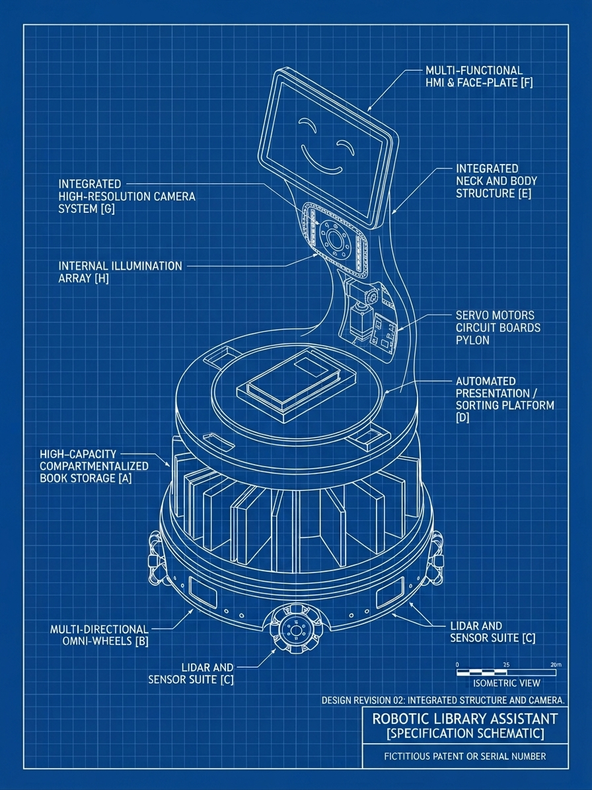

# Library-Book-Robot

A library robot that adapts how it interacts to where it is (quiet zone or common area) and who it is with (one visitor or a group). It scans a book placed on its pad, then returns it, explains it, or recommends something similar.

The robot software runs on a Jetson Orin Nano (JetPack 6, Python 3.10+). The language model, speech and face models run on a separate AI server, reached over TCP. Motors, lights and the printer will hang off an ESP32. See [docs/architecture.md](docs/architecture.md) for how the parts fit together.

## First prototype design



*Concept blueprint, design revision 02, generated with Gemini. It is an AI-generated illustration of the idea, not an engineering drawing: the dimensions, the "patent" number and some details are made up.*

| Label | Part | Where it lives in this repo |
|---|---|---|
| A | Compartmentalised book storage (the ring of slots) | `robot/actuation/storage_ring.py`, `slot` in the catalogue |
| B | Multi-directional omni-wheels | `robot/actuation/navigation.py` |
| C | Lidar and sensor suite | not started |
| D | Presentation / sorting platform (the scan pad) | `robot/perception/book_scanner.py` |
| E | Neck and body structure | `robot/actuation/neck.py` |
| F | HMI and face plate (the screen) | `display/` |
| G | High-resolution camera | `robot/drivers/camera.py` |
| H | Internal illumination array | `robot/actuation/lights.py` |

The servo motors and circuit boards sit in the pylon behind the neck; the ESP32 plan is in `firmware/esp32/README.md`.

## Layout

```
config/            robot.yaml (server, devices, thresholds), styles.yaml (behaviour per context), zones.yaml
robot/             the robot program: python -m robot check | sim | run
  app.py           wires drivers, core logic and the bus together
  bus.py           in-process asyncio publish/subscribe
  events.py        the events on the bus (ContextChanged, BookScanned, UserUtterance, ...)
  config.py        loads config/*.yaml
  perception/      book_scanner (barcode -> ISBN -> BookScanned), book_watch (barcode in view -> BookPlaced); people + identity (faces -> person numbers -> ContextChanged); noise level (stub)
  core/            context, style, dialogue state machine, expression blending, session log
  services/        AI server wrappers: llm (client + sentence splitter), speech, vision;
                   isbn (validation), books (catalogue, similar books, Open Library fallback)
  actuation/       voice, face display, lights, neck, storage ring, printer, navigation
  drivers/         audio (PulseAudio), camera (OpenCV), esp32 (not yet), fake (logs only)
  sim/             keyboard simulator
display/           face display: server.py (SSE) + ui/index.html, start_display.sh (kiosk)
vendor/ai_server/  the AI server team's clients (face, emotion, stt, tts) and the protocol + LLM server script
tools/             test tools: chat_test, camera_test, face_enroll, identity_test, get_face_models, server_check, book_scan_test, make_test_barcodes
firmware/esp32/    planned ESP32 serial protocol
tests/             unittest suite
docs/              architecture notes, reference images
data/              catalog.csv (SAMPLE catalogue), test_barcodes/ (barcode PNGs, committed), cache/ and logs/ (generated, gitignored)
```

`vendor/ai_server/` holds the AI server team's files. Keep face.py, emotion.py, stt.py and tts.py unmodified so updates can be dropped in.

## Setup

```bash
git clone https://github.com/json0130/Library-Book-Robot.git
cd Library-Book-Robot
sudo apt install -y python3-yaml python3-opencv pulseaudio-utils libzbar0 sox
pip install pyzbar                  # barcode reading (needs libzbar0); --user --break-system-packages on Ubuntu 24.04
```

PyYAML is the only required package. OpenCV (the camera tools and driver) comes from apt on the Jetson. pyzbar and OpenCV are only imported when a barcode is actually decoded, so the simulator and most tests run without them. pyserial will be needed once the ESP32 driver exists (`pip install -e .[serial]`). Set the AI server address in `config/robot.yaml`, or per shell with `export AI_HOST=<server-ip>` (and `AI_PORT`, default 7898).

## Running the robot

```bash
python -m robot check     # is the AI server reachable?
python -m robot sim       # try the logic from the keyboard: fake hardware, no AI server needed
python -m robot sim --live   # webcam + camera window, face detection, auto-scan, speaker and LLM: step up (hello), show a book, ask, hear the answer
python -m robot run       # on the hardware; for now exits naming the drivers that are missing (esp32)
```

`python main.py ...` forwards to `python -m robot ...`. `python -m robot sim --llm` also uses the AI server's LLM for explain and recommend (see Books).

### Simulator

```
quiet alone | common group   set the zone (or an area from zones.yaml, e.g. reading_room) and alone/group
noise 62 | noise off         a noise reading in dB, which can override the zone
book                         place a book on the pad: scanned by the webcam with --camera, else a random sample book
book <isbn>                  fake camera only: place the book with this ISBN (a catalogue book, or any valid ISBN)
book none                    fake camera only: place a book whose barcode can't be read: the scan fails
scan <image path>            fake camera only: the real barcode decoder reads a photo of a book
return | explain | recommend say that to the robot once it has offered
<anything else you type>     the visitor says it, e.g. "can you explain it?" (`say <text>` also works)
feel <emotion> [confidence]  the camera sees this emotion on the visitor
leave                        everyone walks away
fixed on | fixed off         baseline condition: one style everywhere
help, quit
```

Options: `--llm` (the AI server's LLM words explain and recommend), `--camera` (scan with the real webcam and show a live camera window), `--faces` (find the people the webcam sees with the AI server's face detection: a new face makes the robot say hello, and nobody in view for `perception.leave_after_s` seconds ends the visit; needs `--camera`), `--auto-scan` (start a scan as soon as a book's barcode is held up to the camera, so you don't type `book`; the camera stands in for the pad's weight sensor; needs `--camera`), `--no-preview` (no camera window, e.g. over SSH), `--speak` (speak replies through the speaker with TTS from the AI server, and the face display's mouth moves), `--live` (webcam, faces, auto-scan, speaker and LLM together). With `--live`: step in front of the camera and the robot says hello. Faces are told apart (`person 1`, `person 2`...), so each person is greeted once, even after leaving the view and coming back, and a new face is greeted (see Person IDs below); hold a book's barcode up to the camera (or type `book`); then type "can you explain it?" or "can you recommend something?" and the robot answers aloud. Replies are spoken only in styles with the speech channel (a common area, the default); in a quiet zone they are printed or go through other channels instead, and a quiet zone doesn't greet. With `--faces` the head count comes from the camera, so typing `common group` or `leave` is overridden at the next change. If the TTS server fails, the reply is only shown and the conversation carries on.

After each command it prints the context, the style and the dialogue state, and the fake drivers print what the hardware would do (`[esp32] neck pose=lowered`, `[voice whisper, volume 0.12] ...`). If the face display is running, expressions and the talking mouth show on it; otherwise they are only printed. Each session is logged to `data/logs/session-<time>.jsonl` (`--no-log` turns that off).

```bash
printf 'quiet alone\nbook\ncommon group\nquit\n' | python -m robot sim
```

### Books

When a book is placed on the pad the robot reads its ISBN barcode, looks the book up, and offers to take it back, explain it or recommend something similar.

```bash
python tools/make_test_barcodes.py                       # regenerates the EAN-13 PNGs in data/test_barcodes/ (already committed) from the catalogue
python tools/book_scan_test.py --list                    # the catalogue
python tools/book_scan_test.py --image data/test_barcodes/9780345391803-the-hitchhiker-s-guide-to-the-galaxy.png
python tools/book_scan_test.py --live                    # webcam with an overlay, q quits
python tools/book_scan_test.py --live --size 1280x720    # sharper but about 8 fps; the default is 640x480 (smooth, 30 fps)
```

Point the webcam at a barcode PNG on a screen, or print them. The scanner tries the grayscale image, a contrast-boosted copy, a 2x upscale and the 90, 180 and 270 degree rotations; library stickers and other non-ISBN codes are ignored. This webcam delivers 30 fps at 640x480 but only about 8 fps at 1280x720 (a limit of the camera, not the code), so there is a trade-off between a sharper barcode and a smoother picture. 640x480 is the default (it read barcodes fine in testing); try `--size 1280x720` for small or distant barcodes, and set `devices.camera_width`/`camera_height` in `config/robot.yaml` for the robot. The live view always shows the newest frame and decodes on a second thread, so the scanner never makes the picture lag.

If no ISBN is read within `books.scan_timeout_s` (5 s) the robot asks the visitor to place the book flat with the barcode up.

`data/catalog.csv` is **sample data** (about a dozen well-known books, with summaries written for this project). Replace it with the library's real catalogue: same columns (`isbn13, title, author, genre, tags, summary, shelf, slot`; tags separated by semicolons; lines starting with `#` are ignored). Loading names the file and line of any bad row. For an ISBN not in the catalogue the robot can ask Open Library for the title and author (`books.online_fallback` in `config/robot.yaml`, 3 s timeout, answers cached in `data/cache/`); shelf, slot and summary stay empty and the book can't be returned or recommended from. Recommendations are the catalogue books with the most genre and tag overlap (Jaccard), ties broken by title.

**The LLM's part.** *Explain* and *recommend* are worded by the AI server's LLM, but only from catalogue records: it is shown the book's entry (explain) or the book plus up to three similar catalogue books to choose from (recommend), and told to use nothing else. A recommendation that names none of those candidates is discarded. **Before a book is scanned,** a plain hello gets a greeting and anything else ("what's your name?", "what can you do?") goes to the LLM as small talk with no catalogue, so it names no books and asks the visitor to place one on the pad; without the LLM, who-are-you is still answered. **Follow-ups:** the scanned book stays the topic until the visitor leaves or scans another, so after an answer they can ask for something else about it ("what's it about again?", "any related books?") or a free question ("who wrote it?", "does he get food somehow?"). Free questions go to the LLM with the book's catalogue entry and the conversation so far, and are told to use only that entry; if the LLM is down, who-wrote-it and genre questions are still answered from the catalogue, and anything else gets a short "I can't answer that right now". Saying "another book" (or just "yes") after an answer asks for the next book. *Return* (shelf and storage slot) never goes through the model, and a book that is not in the catalogue is never sent to it. If the server is down, slower than `ai_server.llm_timeout_s` (20 s), or gives an unusable answer, the robot says the plain catalogue text instead. Set `books.use_llm: false` to turn it off; the simulator uses the LLM only with `--llm`, so it still needs no server by default. Each new book starts a fresh conversation, and the last 10 exchanges are kept for the model.

### Person IDs

With `--faces` the first face the camera sees becomes `person 1`, the next new face `person 2`, and a face that comes back after being out of view is recognised as the same person: the robot doesn't greet them again, and the camera window labels each box with the number. The AI server only finds the faces; each box is turned into a face embedding on the robot (OpenCV's SFace model) and compared with the people seen so far. **Privacy:** the embeddings stay in memory for the run only. Nothing is sent to the server or saved, so "person 1" means one person for one run, and nothing about them survives quitting the simulator. (The server's own enrollment, `tools/face_enroll.py`, keeps photos for good and is for named people.)

```bash
python tools/get_face_models.py     # once: downloads the 38.7 MB model into models/face/ (gitignored)
python tools/identity_test.py       # live check: look at the camera, step out and back, let someone else step in
```

`identity_test.py` shows each face's similarity to every person it knows. Set `perception.identity_threshold` in `config/robot.yaml` from what it shows (0.40 by default): if one person keeps turning into a new number, lower it; if two people are merged, raise it. Without the model file the sim says so and falls back to counting faces, greeting once per visit with `dialogue.greet_cooldown_s`. A face that is too small (under 40 px) is not given a number.

### Behaviour rules

How the robot behaves in each context is data, not code: [config/styles.yaml](config/styles.yaml) has one entry per `quiet_alone`, `quiet_group`, `common_alone` and `common_group`, plus `fixed` (the study baseline) and `default` (the safe fallback, and the source of any field an entry leaves out). Each entry sets the voice (normal or whisper) and volume, the channels a message goes through (speech, screen, gaze, spotlight, print), light colour and brightness, the resting eye expression, neck pose, screen layout, whether the robot approaches people, and the speed limit. [config/zones.yaml](config/zones.yaml) maps named areas to zones and sets the noise thresholds.

## Face display

```bash
display/start_display.sh          # server + Chromium kiosk on http://localhost:8765 (falls back to chromium-browser, firefox)
python -m display.server          # server only; open http://localhost:8765 (--port 9000 to change)
```

Type in the server's terminal: an emotion with optional hold seconds (`happy`, `sad 5`), `idle`, `talk [seconds]`, `list`, `quit`. Or over HTTP:

```bash
curl -X POST localhost:8765/emotion -H 'Content-Type: application/json' -d '{"emotion":"happy","hold_s":3}'
curl 'localhost:8765/emotion?name=surprised&hold=5'
curl 'localhost:8765/talk?seconds=3'              # move the mouth for 3 s; seconds=0 stops
```

Emotions: happy, sad, angry, surprise, fear, disgust, neutral (aliases such as `scared`, `mad`, `joy` work). From Python: `robot.actuation.face.set_emotion("happy", hold_s=3.0)`. Open `display/ui/index.html?emotion=happy` to view one frozen face without a server (`&talk=0.7` opens the mouth); add `?glow=cheap` or `?glow=off` if the Jetson drops frames.

## Test tools

These talk to the AI server and the hardware directly, without the robot program. Run them from the repo root.

### AI server

On the server: `python llm.py receive --host 0.0.0.0` (port 7898; allow it through the firewall). On the Jetson:

```bash
python tools/server_check.py       # is the server reachable?
python tools/chat_test.py          # --llm: type, read the reply (default)
python tools/chat_test.py --stt    # speak, read the transcript
python tools/chat_test.py --tts    # type, hear it spoken
python tools/chat_test.py --talk   # type, hear the reply: LLM -> TTS
python tools/chat_test.py --chat   # speak, hear the reply: STT -> LLM -> TTS

python tools/chat_test.py --prompt "Recommend a book about robots."   # one --llm/--tts/--talk turn
python tools/chat_test.py --chat --wav question.wav                   # one voice turn from a file
```

Voice modes: press Enter, speak, press Enter again. Recording and playback use PulseAudio (`parecord`/`paplay`). `--mic Webcam` and `--speaker USB` (or `MIC` / `SPEAKER`) pick devices by part of the name in `pactl list short sources` / `sinks`. Recordings quieter than `--min-rms` (default 500) are skipped, because STT invents text like "Thank you." from silence.

The system prompt casts the model as Stuart, the Library Book Robot (the name is in `robot/persona.py`): upbeat and energetic, free to chat about everyday things, told not to greet or introduce itself twice. Each prompt carries the conversation as it really went, the last 10 exchanges, including the robot's fixed lines (hello, "You have <title>...") and what the visitor said, so the model knows what was already said; another book starts a new conversation, but the chat before the first book of a visit carries on. The server takes one prompt string, so the system prompt and history are flattened into it as `System:` / `User:` / `Assistant:` lines. If the face display is running, the mouth moves with each reply (with the speech audio in `--tts`, `--talk` and `--chat`; tune `--lip-delay` if it is out of sync).

### Camera and faces

```bash
python tools/camera_test.py                  # live names (same as --recognition), q quits
python tools/camera_test.py --detect         # live face boxes only
python tools/camera_test.py --emotion        # live emotion per face
python tools/face_enroll.py jay              # enroll 5 webcam photos as "jay"

python vendor/ai_server/face.py --host <server-ip> --image photo.jpg --operation recognize
python vendor/ai_server/emotion.py --host <server-ip> --image photo.jpg
```

The server stores enrollment photos in its `models/face/known_faces/<name>/` and needs exactly one face per photo, so enrolling crops each frame to the largest face. Recognition matches when similarity is at least 0.6.

### Without the server

```bash
python -m vendor.ai_server.llm receive --mock &     # echo server on 127.0.0.1:7898
python tools/chat_test.py --host 127.0.0.1 --prompt "hi"
python -m unittest discover -s tests -t .           # the test suite
```

## Next

1. ESP32 firmware and `robot/drivers/esp32.py`, then `python -m robot run` on the hardware.
2. Perception: noise level feeding `ContextChanged` (people counting is done: `robot/perception/people.py`, used by `sim --faces`); the pad's weight sensor publishing `BookPlaced` from the ESP32.
3. Replace the sample catalogue with the library's real one.
4. Speak replies sentence by sentence to cut the TTS delay (about 5 s for a three-sentence reply today).
