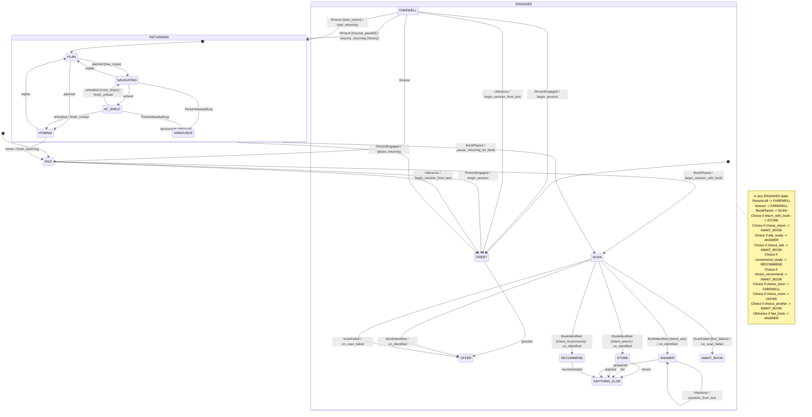

# State machine

The robot's behaviour is a hierarchical, table-driven state machine: `robot/core/fsm.py` is the generic machine
(nesting, history, guards, timers, entry and exit actions, `force()`), and `robot/core/dialogue.py` is the table on top
of it. **This file is generated from that table** (`python -m robot states --write`), and a test fails if it is out of
date, so what you read here is what the robot does.

How to read it:

- The active state is always a leaf; its path is written `ENGAGED.OFFER`.
- An event is tried in the active state first and then in each enclosing state; the first transition whose guard is
  true wins. A transition with no target is *internal*: its action runs and the state does not change.
- `Choice` is a screen button (or the visitor saying a choice in words), `Utterance` is anything else they say.
  Every event carries a source: `sensor`, `operator` (terminal or `/operator` page), `screen` (a touch button) or
  `timeout`; each transition is logged with it, the zone and the time.
- Timers are config values (`timeouts`, `returning`, `storage` in `config/robot.yaml`). Every waiting state has a
  timeout and a `PersonLeft` way out, and both end in `FAREWELL` (silent in a quiet zone: eyes and light only).
- The zone (quiet or common) and the fixed baseline mode are style settings, not states: the same state behaves
  differently through `config/styles.yaml`.

## Diagram

## States

| state | inside | waits | timers (config key) | what it does |
|---|---|---|---|---|
| IDLE |  |  |  | waiting; nobody is engaging |
| ENGAGED |  |  |  | a visitor is here (composite, starts in GREET) |
| GREET | ENGAGED |  |  | hello, once per person |
| OFFER | ENGAGED | yes | `timeouts.offer_s` | return a book, ask about a book, or get a recommendation |
| AWAIT_BOOK | ENGAGED | yes | `timeouts.await_book_s` | the choice needs a book: ask for one |
| SCAN | ENGAGED | yes | `timeouts.scan_s` | the BookReader is reading the book |
| STORE | ENGAGED | yes | `timeouts.store_s`, `storage.sim_drop_s` → BookDropped | slot, ring, light, pad pulse; wait for BookDropped |
| ANSWER | ENGAGED | yes | `timeouts.answer_s` | explain, where, guide, free questions |
| RECOMMEND | ENGAGED |  |  | from the book graph |
| ANYTHING_ELSE | ENGAGED | yes | `timeouts.anything_else_s` | more help or done |
| FAREWELL | ENGAGED |  | `timeouts.farewell_s`, plus `returning.auto_start_delay_s` when books are waiting | goodbye, then IDLE or RETURNING |
| RETURNING |  |  |  | putting the stored books back (composite, starts in PLAN) |
| PLAN | RETURNING |  |  | group the stored books by shelf |
| NAVIGATING | RETURNING |  | `returning.sim_drive_s` → arrived | driving to the next shelf (simulated) |
| AT_SHELF | RETURNING |  | `returning.sim_unload_s` → unloaded | unloading (simulated) |
| ANNOUNCE | RETURNING |  | `returning.announce_s` → announced | excuse me: signal without starting a conversation |
| HOMING | RETURNING |  | `returning.sim_drive_s` → home | driving home (simulated) |

## Transitions

| in | event | guard | goes to | action | note |
|---|---|---|---|---|---|
| IDLE | PersonEngaged |  | GREET | begin_session |  |
| IDLE | BookPlaced |  | SCAN | begin_session_with_book |  |
| IDLE | Utterance |  | GREET | begin_session_from_text | speech means a person is here |
| ENGAGED | PersonLeft | recently_active | (stays) | doubt_left | the camera lost them but they just spoke or tapped: wait for leave_grace_s of quiet |
| ENGAGED | PersonLeft |  | FAREWELL |  |  |
| ENGAGED | timeout | person_present | (stays) | keep_waiting | still there, just quiet: wait again, no goodbye |
| ENGAGED | timeout |  | FAREWELL |  |  |
| ENGAGED | BookPlaced |  | SCAN | book_placed |  |
| ENGAGED | Choice | return_with_book | STORE | choose |  |
| ENGAGED | Choice | choice_return | AWAIT_BOOK | choose |  |
| ENGAGED | Choice | ask_ready | ANSWER | choose |  |
| ENGAGED | Choice | choice_ask | AWAIT_BOOK | choose |  |
| ENGAGED | Choice | recommend_ready | RECOMMEND | choose |  |
| ENGAGED | Choice | choice_recommend | AWAIT_BOOK | choose |  |
| ENGAGED | Choice | choice_done | FAREWELL | choose |  |
| ENGAGED | Choice | choice_more | OFFER | choose |  |
| ENGAGED | Choice | choice_another | AWAIT_BOOK | another_book |  |
| ENGAGED | Choice | choice_guide | (stays) | guide_now |  |
| ENGAGED | Utterance | has_book | ANSWER | question_from_text |  |
| ENGAGED | Utterance |  | (stays) | chat |  |
| GREET | greeted |  | OFFER |  |  |
| OFFER | Utterance | book_statement | (stays) | repeat_offer | not a question |
| GREET | Choice |  | (stays) |  |  |
| GREET | Utterance |  | (stays) |  |  |
| AWAIT_BOOK | Utterance |  | (stays) | chat |  |
| SCAN | BookIdentified | intent_return | STORE | on_identified |  |
| SCAN | BookIdentified | intent_ask | ANSWER | on_identified |  |
| SCAN | BookIdentified | intent_recommend | RECOMMEND | on_identified |  |
| SCAN | BookIdentified |  | OFFER | on_identified |  |
| SCAN | ScanFailed | first_failure | AWAIT_BOOK | on_scan_failed |  |
| SCAN | ScanFailed |  | OFFER | on_scan_failed |  |
| SCAN | BookPlaced |  | (stays) |  |  |
| SCAN | Choice |  | (stays) |  |  |
| SCAN | Utterance |  | (stays) | say_busy |  |
| STORE | BookDropped |  | (stays) | commit_store | the book is stored |
| STORE | stored |  | ANYTHING_ELSE |  | after BookDropped |
| STORE | full |  | ANYTHING_ELSE |  |  |
| STORE | rejected |  | ANYTHING_ELSE |  |  |
| STORE | BookPlaced |  | (stays) |  |  |
| STORE | Choice |  | (stays) |  |  |
| STORE | Utterance |  | (stays) | say_busy |  |
| ANSWER | answered |  | ANYTHING_ELSE |  |  |
| ANSWER | Utterance |  | ANSWER | question_from_text |  |
| RECOMMEND | recommended |  | ANYTHING_ELSE |  |  |
| RECOMMEND | Choice |  | (stays) |  |  |
| RECOMMEND | Utterance |  | (stays) |  |  |
| FAREWELL | PersonEngaged |  | GREET | begin_session |  |
| FAREWELL | Utterance |  | GREET | begin_session_from_text |  |
| FAREWELL | PersonLeft |  | (stays) |  |  |
| FAREWELL | Choice |  | (stays) |  |  |
| FAREWELL | timeout | resume_paused | RETURNING (history) | resume_returning | after the delay |
| FAREWELL | timeout | auto_return | RETURNING | start_returning | after the delay |
| FAREWELL | timeout |  | IDLE |  |  |
| RETURNING | PersonEngaged |  | GREET | pause_returning |  |
| RETURNING | BookPlaced |  | SCAN | pause_returning_for_book |  |
| PLAN | planned | has_stops | NAVIGATING |  |  |
| PLAN | planned |  | HOMING |  |  |
| NAVIGATING | arrived |  | AT_SHELF |  |  |
| NAVIGATING | PersonNearbyBusy |  | ANNOUNCE |  |  |
| NAVIGATING | replan |  | PLAN |  |  |
| AT_SHELF | unloaded | more_stops | NAVIGATING | finish_unload |  |
| AT_SHELF | unloaded |  | HOMING | finish_unload |  |
| AT_SHELF | PersonNearbyBusy |  | ANNOUNCE |  |  |
| ANNOUNCE | announced |  | RETURNING (previous) |  |  |
| HOMING | home |  | IDLE | finish_returning |  |
| HOMING | replan |  | PLAN |  |  |
