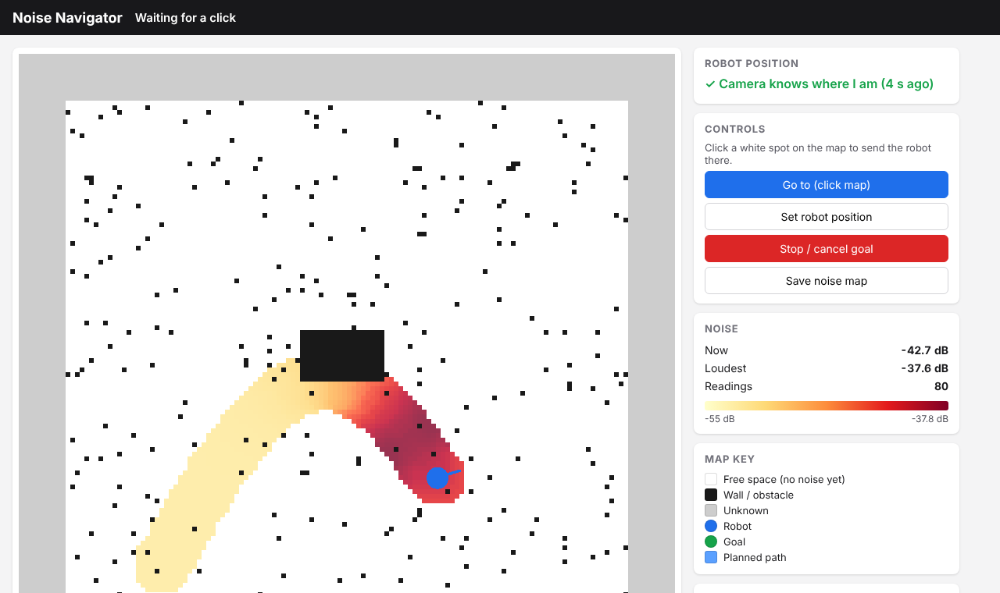
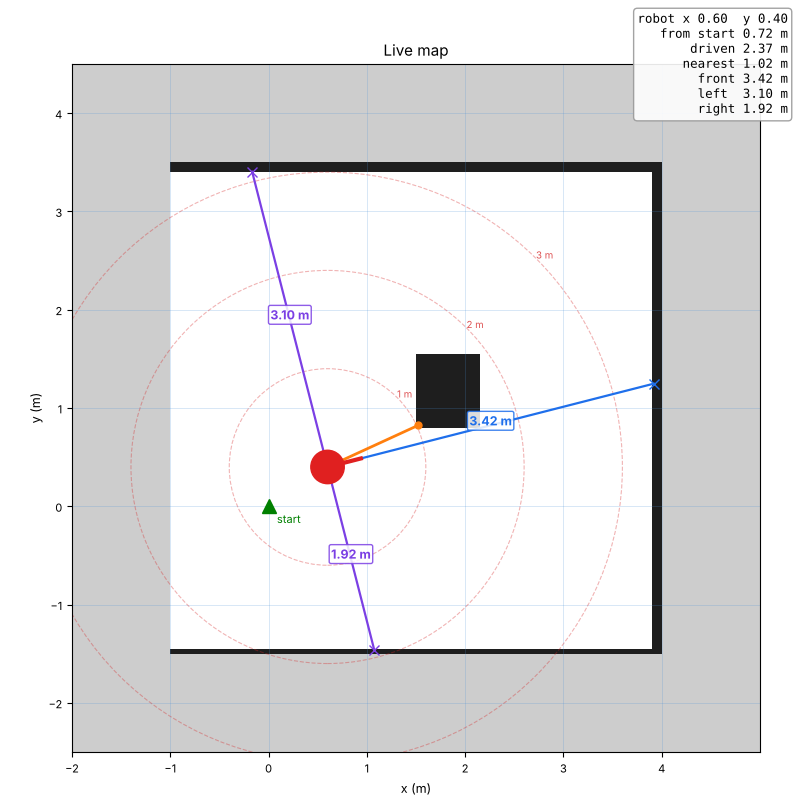

# TurtleBot Noise Mapping

A TurtleBot 2 that makes a map of a room with its **camera (visual SLAM)**, then
**drives itself to wherever you click on that map** while two microphones measure
how loud it is. The noise is painted onto the map live, so you can see which
areas are noisy and which side of the robot the sound came from.

Everything is controlled from a web browser on your own PC (Windows, Mac or
Linux) over SSH. Nothing needs to be installed on the PC.


*The click-to-go page, shown with simulated test data. Yellow = quiet, dark red = loud.*

---

## Contents

- [What it does](#what-it-does)
- [Hardware](#hardware)
- [How it works](#how-it-works)
- [Repository layout](#repository-layout)
- [What each file does](#what-each-file-does)
- [Installation (once)](#installation-once)
- [Watching from your PC](#watching-from-your-pc)
- [Part 1 - Make the map](#part-1---make-the-map)
- [Part 2 - Noise map with click-to-go navigation](#part-2---noise-map-with-click-to-go-navigation)
- [Link to the Jetson](#link-to-the-jetson)
- [Two ways to localise](#two-ways-to-localise)
- [Output files](#output-files)
- [Settings you can change](#settings-you-can-change)
- [Troubleshooting](#troubleshooting)
- [Limitations](#limitations)
- [Background](#background)

---

## What it does

**Part 1 - Make the map** (`run_vslam_mapping.sh`)
- You drive the robot around with the keyboard.
- **RTAB-Map** (visual SLAM) uses the depth camera to work out where the robot
  is and to draw a 2D map of the room.
- The map is shown live in your browser, with distances: a 1 m grid,
  1 / 2 / 3 m rings around the robot, and the distance to the nearest obstacle
  in front, left and right.
- When you press Ctrl-C the map is saved (`~/vslam_map.db` + a `.png` picture).

**Part 2 - Noise map** (`run_vslam_noise_nav.sh`)
- Open a web page, **click a white spot on the map** and the robot plans a route
  and drives there by itself.
- The **camera** recognises the room and works out where the robot is on the
  saved map (no LiDAR needed for this).
- The **LiDAR** spots obstacles while driving so the robot doesn't hit them.
- **Two USB microphones** (left and right side of the robot) measure the noise
  every half second. Each reading is painted onto the map: the **left half**
  of the painted circle uses the **left mic**, the **right half** the **right
  mic**, so the side the sound came from shows up darker.
- Press Ctrl-C (or the **Save** button) to save the noise map picture and a CSV
  of every reading.

---

## Hardware

| Part | Used for | Needed in |
|---|---|---|
| TurtleBot 2 (Kobuki base) + laptop, Ubuntu 20.04, ROS Noetic | Driving, odometry | Part 1 + 2 |
| Orbbec Astra depth camera (the TurtleBot's normal 3D sensor) | Visual SLAM + finding the robot on the map | Part 1 + 2 |
| Hokuyo URG-04LX-UG01 LiDAR | Obstacle avoidance while driving | Part 2 |
| 2 cheap USB microphones, one on each side of the robot | Left / right noise | Part 2 (optional - falls back to the camera's mic) |
| Any PC with SSH and a web browser | Watching and clicking | Part 1 + 2 |

**Mounting tips**
- LiDAR: mounted level, facing forward, on the robot's top plate.
- Microphones: on **opposite sides**, facing **outwards**, as far apart as possible
  (about 30 cm), away from the wheels and the laptop fan. The robot's body
  between them helps each mic hear its own side.

---

## How it works

```
 PART 1 - MAPPING                               PART 2 - NOISE MAPPING
 -------------------------                      -------------------------------------------
 keyboard -> robot base                          web page click -> move_base (plans a path, drives)
 wheels   -> odometry ---------+                                     ^             ^
 camera   -> RTAB-Map (SLAM) --+-> /map          camera -> RTAB-Map (localization) -> robot position on map
                                |                 /map -> map_cleaner -> /map_clean (planner's map)
                         map_viewer.py            LiDAR -> scan_filter -> obstacle avoidance
                                |                 2 USB mics -> noise_logger -> /noise_reading
                       browser :8080                                   |
                                                         noise_nav_web.py (map + noise + clicks)
                                                                       |
                                                                 browser :8000
```

| Node / file | What it does |
|---|---|
| `config/vslam.launch` | Starts the camera, RTAB-Map (mapping or localization), the LiDAR and move_base |
| `nodes/map_viewer.py` | Draws the live map with distances, for the browser (Part 1) |
| `nodes/scan_filter.py` | Removes LiDAR points that hit the robot itself (closer than 25 cm) |
| `nodes/map_cleaner.py` | Removes small noisy black specks from the camera map, so the planner can find a path |
| `nodes/noise_logger.py` | Reads the left + right mics, publishes the loudness, saves a CSV |
| `nodes/noise_nav_web.py` | The click-to-go web page: map, noise colours, robot position, buttons |
| `config/hokuyo_costmap.yaml` | Navigation settings (LiDAR obstacles, safety margin, speed, planner) |

---

## Repository layout

```
turtlebot/                     (a folder of the Library-Book-Robot repository)
├── run_vslam_mapping.sh       Part 1 - one command starts everything for mapping
├── run_vslam_noise_nav.sh     Part 2 - one command starts everything for noise mapping
├── run_robot_link.sh          Part 2 plus the link to the Jetson (robot_link_api); see "Link to the Jetson"
├── run_lidar_mapping.sh       makes the LiDAR map for run_robot_link.sh --amcl (see "Two ways to localise")
├── measure_localisation.py    how often the localiser places the robot (RTAB-Map or AMCL), only listens
├── keepout.py                 keep-out zones: read, check, paint (map_cleaner.py, the run script and tools/ use it)
├── check_devices.sh           shows what is plugged in where (LiDAR, base, camera, mics)
├── setup_mics.py              one-time setup: which USB mic is left / right
├── calibrate_noise.py         one-time setup: turn the mics' dBFS into dB with a phone sound meter
├── config/
│   ├── vslam.launch           camera + RTAB-Map + LiDAR + move_base
│   ├── amcl_nav.launch        LiDAR + saved map + AMCL + move_base (+ the depth camera for obstacles, the safety controller)
│   ├── depth_obstacles.launch the Astra depth only (320 x 240, 6 Hz) -> 5 cm point cloud, never for localising
│   ├── depth_costmap.yaml     the depth cloud in both costmaps (5 cm to robot height + 5 cm)
│   ├── robot_shape.yaml       the robot's outline and inflation (measured: 0.18 m all round)
│   ├── keepout.yaml           keep-out zones on the LiDAR map (under the desks)
│   ├── lidar_mapping.launch   LiDAR + gmapping (no camera)
│   └── hokuyo_costmap.yaml    navigation settings
├── nodes/
│   ├── map_viewer.py
│   ├── map_cleaner.py         removes specks; paints the keep-out zones into /map_clean
│   ├── scan_filter.py
│   ├── noise_logger.py
│   ├── noise_nav_web.py
│   ├── set_initial_pose.py    sends the station pose to AMCL at start-up
│   └── robot_link_api.py      the HTTP API for the Jetson (port 8010)
├── robot_link/                the API's logic in plain Python 3.8 (no ROS), tested in tests/
├── maps/                      LiDAR maps made by run_lidar_mapping.sh (ignored by git)
├── tests/                     python3 -m unittest discover -s tests
├── docs/images/               screenshots from simulated tests
└── extras/                    earlier experiments (LiDAR-only SLAM, first noise maps)
```

Maps, recordings and logs are saved in the robot's **home folder** (`~`), not in
the repo (see `.gitignore`). The exceptions are `run_robot_link.sh` and
`run_lidar_mapping.sh`: they keep everything in this folder (`run_data/`,
`run_logs/`, `maps/`) and never write to the home folder.

---

## What each file does

A closer look at every file in the main folder: what it's for, what it reads
and sends, and how it works inside.

### `run_vslam_mapping.sh` - Part 1 launcher

**Purpose:** starts everything needed to make a camera map, in the right order,
in one terminal window.

**Steps it runs:**
1. **Checks** that ROS isn't already running, the repo files exist, and RTAB-Map
   is installed (it picks `rtabmap_slam`, or the older `rtabmap_ros`). Warns you
   if the map name already exists, because it would be replaced.
2. **Robot base:** `roslaunch turtlebot_bringup minimal.launch`, then waits until
   `/odom` (wheel odometry) arrives. If it doesn't, the base is off or unplugged.
3. **Camera + RTAB-Map:** `config/vslam.launch use_lidar:=false`, then checks
   that colour and depth images arrive, that the robot knows where the camera is
   mounted (TF `base_footprint → camera_rgb_optical_frame`), and that a `/map`
   appears.
4. **Viewer:** `nodes/map_viewer.py` + `web_video_server`, which serves port 8080.
5. **Keyboard control** in the same window (`keyboard_teleop.launch`).
6. **On Ctrl-C:** saves the 2D map with `map_saver` (`.pgm` + `.yaml`), turns it
   into a `.png`, then stops every program in reverse order. RTAB-Map writes the
   `.db` file as it shuts down.

**Notes:**
- Each program's output goes to `~/run_logs/<name>.log`, so the window only shows
  the script's own green (`>>>`) and red (`!!!`) messages.
- It finds its own files from the folder it's in, so it works wherever you clone
  the repo.

### `run_vslam_noise_nav.sh` - Part 2 launcher

**Purpose:** starts everything for the click-to-go noise map.

**Steps it runs:**
1. **Checks:** the map `.db` exists, the repo files are there, and RTAB-Map is
   installed.
2. **Finds the LiDAR** by its serial ID (`/dev/serial/by-id/*Hokuyo*`), so it
   works on any USB port, and gives it read/write permission (`sudo chmod`).
3. **Checks for `~/mic_config.json`.** Without it, the camera mic is used.
4. Keeps the **previous noise map** as `*_prev.png` / `*_prev.csv`.
5. Starts, in order, checking each one:

   | Order | Program | Waits for |
   |---|---|---|
   | 1 | Robot base (`minimal.launch`) | `/odom` |
   | 2 | `config/vslam.launch localization:=true navigation:=true` | LiDAR `/hokuyo_scan`, camera images, `/map`, `move_base` |
   | 3 | `nodes/scan_filter.py`, `nodes/map_cleaner.py` | `/map_clean` |
   | 4 | `nodes/noise_logger.py` | `/noise_level` |
   | 5 | `nodes/noise_nav_web.py` (port 8000) + `web_video_server` (port 8080) | - |

6. **Prints** the `ssh` tunnel command with this robot's IP address.
7. **Waits.** Every 5 s it checks that navigation is still running.
8. **On Ctrl-C:** stops everything in reverse order. The web page saves the noise
   map and CSV as it closes.

**Why there's no keyboard control:** while teleop runs, it sends "speed 0" ten
times a second, and the robot's command mixer always obeys the keyboard over
navigation. So clicks would never move the robot.

### `check_devices.sh` - what is plugged in

Prints:
- the LiDAR (`/dev/serial/by-id`, `/dev/ttyACM*`);
- the robot base (`/dev/kobuki`);
- whether the Orbbec camera is on USB (vendor ID `2bc5`);
- all USB devices;
- every sound card, with its **USB port** (for example `1-2.6`);
- the saved mic setup.

Use it after moving cables around.

### `setup_mics.py` - which mic is left and which is right

The two cheap USB mics report **identical names**, and their card numbers can
change after a reboot, so they're identified by **physical USB port** instead.

1. **Finds USB microphones.** It ignores the camera's mic and the laptop's
   built-in mic.
2. **Clap test:** records **all mics at the same time** while you clap next to
   the left mic, then the right one. For each mic it measures the level of the
   loudest 5% of 20 ms frames, which is where the claps are. The mic that's much
   louder for left claps becomes **left**, and the other becomes **right**. It
   insists on at least a 2 dB difference, otherwise it asks you to repeat.
3. **Calibration:** with a steady sound in front, which reaches both mics equally,
   it measures how many dB louder the left mic reads (the median over the loud
   frames). That **offset** is later subtracted, so both mics are compared fairly.
4. **Saves** `~/mic_config.json`, with the left and right USB ports, the names
   and the offset.

### `config/vslam.launch` - camera, SLAM, LiDAR and navigation

One launch file used by both parts. The main options:

| Option | Part 1 | Part 2 | Meaning |
|---|---|---|---|
| `localization` | false | true | false = build a new map (the old `.db` is deleted); true = load the map and only work out where the robot is |
| `navigation` | false | true | Also start `move_base` (path planning + driving) |
| `use_lidar` | false | true | Start the Hokuyo driver |
| `rtabmap_use_scan` | - | false | RTAB-Map itself uses only the camera; the LiDAR is just for obstacles |
| `grid_sensor` | 1 | 1 | The 2D map is drawn from the camera (0 = LiDAR, 2 = both) |
| `database_path` | `~/vslam_map.db` | same | Map file |
| `port`, `laser_z`, `laser_yaw` | - | auto | LiDAR port and mounting |

**What it starts:**
- **Hokuyo driver** (`urg_node`), publishing `/hokuyo_scan`, plus a fixed
  transform saying where the LiDAR sits on the robot (`base_footprint → laser`).
- **The camera:** the TurtleBot's `3dsensor.launch`, which gives colour images,
  depth images, and the camera's position on the robot.
- **RTAB-Map**, which:
  - takes the colour + depth images plus the wheel odometry;
  - finds visual features (corners, edges) in each image, and uses their depth
    to work out how the robot moved;
  - remembers what each place looks like, so when it sees a place again it
    corrects the drift (**loop closure**);
  - turns the depth points into a 2D map: floor = free, anything up to 1.2 m
    tall = obstacle, ceiling ignored; isolated noisy points are filtered out;
  - publishes the map on `/map`;
  - in localization mode, publishes `/rtabmap/localization_pose` each time it
    recognises a place;
  - accepts `/initialpose`, which is what the "Set robot position" button sends.
- **move_base** (when `navigation:=true`): the standard TurtleBot navigation, with
  the settings from `hokuyo_costmap.yaml`. It reads the obstacles from
  `/hokuyo_scan_filtered`.

### `config/hokuyo_costmap.yaml` - navigation settings

Changes from the TurtleBot defaults:
- **Uses the LiDAR at any mounting height.** By default, only scans between
  0.25 and 0.35 m are accepted.
- **Plans on `/map_clean`,** the camera map with the specks removed.
- **Safety margin (inflation) of 0.30 m,** so narrow gaps aren't closed off.
  The robot itself is about 0.18 m in radius.
- **Top speed of 0.25 m/s.**
- **The planner may go through grey (unknown) areas** (`allow_unknown: true`),
  and accepts a goal within 0.3 m if the clicked spot itself is blocked.

### `nodes/map_viewer.py` - live map with distances (Part 1)

| | |
|---|---|
| Reads | `/map`, robot position (TF `map → base_footprint`) |
| Sends | `/map_image` (picture, 2 per second) → viewed through `web_video_server` |

**How it works:**
- **Crops** the map to the explored area, and draws free = white, walls = black,
  unknown = grey.
- **Adds a 1 m grid**, and rings at 1, 2 and 3 m around the robot.
- **Distance lines:** casts a ray **forward, left and right** from the robot,
  stepping 2.5 cm at a time, until it hits a black cell. That distance is shown
  in metres. A ray that reaches grey first is drawn dotted, with "?".
- **Nearest obstacle:** finds the closest black cell within 5 m (orange line).
- **Info box:** position, distance from the start, and distance driven. Jumps
  over 1 m are ignored, because those happen when SLAM corrects itself.

### `nodes/scan_filter.py` - ignore the robot's own body

| | |
|---|---|
| Reads | `/hokuyo_scan` |
| Sends | `/hokuyo_scan_filtered` |

The LiDAR sees parts of the TurtleBot (posts, cables, the camera). Without this,
navigation thinks the robot is already touching an obstacle and refuses to move
("potential collision, cost -1"). Every reading closer than `min_range`
(0.25 m) is replaced with "no reading".

### `nodes/map_cleaner.py` - remove specks from the camera map

| | |
|---|---|
| Reads | `/map` |
| Sends | `/map_clean` (latched, so late subscribers still get it) |

The camera map has many small black specks, from noisy depth near chair legs and
shiny or dark surfaces. The planner treats each one as a wall, plus a safety
margin, so it often found **no path at all**. This node fixes that:
1. **Finds the black blobs:** groups black cells that touch, including
   diagonally, into blobs (8-connected component labelling, using scipy if
   installed, otherwise a simple flood fill).
2. **Removes small ones:** any blob smaller than `min_area` (0.05 m², about
   22 × 22 cm) becomes free space. Walls and furniture are big connected blobs,
   so they stay.
3. **Publishes** the cleaned map.

Real small obstacles that get removed are still avoided, because the LiDAR sees
them live while driving.

### `nodes/noise_logger.py` - measure the noise

| | |
|---|---|
| Reads | Left + right USB mics (or the camera mic), robot position from `/odom` |
| Sends | `/noise_level`, `/noise_left`, `/noise_right`, `/noise_balance`, `/noise_reading` |
| Saves | CSV (`~/noise_log.csv` when started by the run script) |

**How it works:**
1. **Picks the mics:** looks up the current card number for each saved USB port
   in `~/mic_config.json`, and records each mic with `arecord` (16 kHz, mono) in
   its own background thread.
2. **Measures loudness:** every **0.5 s** it takes one reading per mic:
   - `peak` (default): the RMS of the **loudest 50 ms** in that half second, so
     claps and short sounds aren't averaged away;
   - `average`: the RMS of the whole half second.
3. **Converts to dB:** `dB = 20·log10(rms / 32768)`, so 0 dB is the loudest the
   mic can record. The left mic's calibration offset is subtracted.
4. **Combines the mics:**
   - **overall** = the average sound *power* of both mics (not an average of the
     dB numbers);
   - **balance** = left − right. More than +1.5 dB means **LEFT**, less than
     −1.5 dB means **RIGHT**, anything else is **centre**.
5. **Keeps the mics in step:** the two USB mics have separate clocks, so if one
   runs ahead, its old readings are dropped.
6. **Without `mic_config.json`:** reads the camera's stereo mic instead.

When run next to the Jetson link it also listens to `/robot_speaking` and `/odom` and leaves the robot's own noise out of the CSV (see "Link to the
Jetson"; `_skip_when_busy:=false` turns it off). If `~/noise_calibration.json` exists it adds three CSV columns (`sound_dB`, `left_sound_dB`,
`right_sound_dB`: real dB) and publishes `/noise_reading_db`; `/noise_reading` itself stays in dBFS.

### `nodes/noise_nav_web.py` - the click-to-go noise map page

The main program for Part 2. It's a small web server, built into Python, plus a
ROS node.

| | |
|---|---|
| Reads | `/map_clean` (or `/map`), `/noise_reading`, robot position (TF), planned path, `/rtabmap/localization_pose` |
| Sends | Goals to `move_base` (action), `/initialpose`, `/move_base/clear_costmaps` |
| Serves | `http://localhost:8000` (only reachable through the SSH tunnel) |
| Saves | `~/noise_nav_map.png`, `~/noise_nav_log.csv` |

**Painting the noise:** every reading paints a **circle 0.4 m in radius** around
the robot, split along the direction the robot faces:
- the **left half** gets the **left mic's** dB, and the right half the right
  mic's;
- for each map cell it stores the **sum, count and maximum** of all readings
  painted there;
- **Loudest** view colours each cell by its maximum, and **Average** view by
  sum ÷ count;
- colours run from **yellow** (quietest so far) through orange to **dark red**
  (loudest so far);
- walls are never painted over.

**Clicks:**
- **A click on the map:** the position is turned into map coordinates. Walls and
  grey areas are refused. It clears old obstacles, then sends a goal to
  `move_base`, facing from the robot towards the clicked point.
- **Set robot position:** two clicks, where the robot is and which way it faces.
  These go to RTAB-Map on `/initialpose`.

**The page itself** (HTML + JavaScript inside the same file) refreshes the map
picture and the status once a second. The status includes the nav state, the
noise now and loudest, the direction, the position, and whether the camera has
recognised the room recently.

| Web address | What it does |
|---|---|
| `GET /` | The page |
| `GET /map.png` | Current map picture |
| `GET /api/status` | Status as JSON |
| `POST /api/goal`, `/api/pose`, `/api/cancel`, `/api/clear`, `/api/save`, `/api/view` | The buttons |


---

## Installation (once)

All commands are run **on the robot's laptop** (over SSH from your PC is fine:
`ssh robot@<robot-ip>`).

### 1. ROS packages

The standard TurtleBot 2 packages (`turtlebot_bringup`, `turtlebot_teleop`,
`turtlebot_navigation`) must already be installed. Then:

```bash
sudo apt update
sudo apt install ros-noetic-rtabmap-ros ros-noetic-urg-node \
                 ros-noetic-web-video-server ros-noetic-map-server \
                 python3-numpy python3-matplotlib
# optional, makes the map cleaner faster:
sudo apt install python3-scipy
```

Check everything is found (each line should print a folder, not "not found"):

```bash
rospack find rtabmap_slam; rospack find urg_node; rospack find web_video_server
rospack find map_server; rospack find turtlebot_navigation; rospack find move_base
```

### 2. Get the code

Clone the repository onto the robot's laptop (its URL is in the project's
GitHub page; `git remote -v` in your own copy shows it), then go into the
`turtlebot` folder, the one that contains this README:

```bash
cd ~
git clone <repository-url> lbr-dell
cd lbr-dell/turtlebot
chmod +x *.sh *.py nodes/*.py
```

(The folder's name does not matter. The scripts only use the files next to
them, never the copies that may sit in your home folder from before the
repository existed.)

All the commands below are run from this folder. The scripts find their other
files relative to where they are, so the folder can live anywhere.

### 3. Camera setting

The TurtleBot must know the camera model, so it knows where the camera sits on
the robot:

```bash
echo $TURTLEBOT_3D_SENSOR        # should print: astra
```

If it doesn't, add `export TURTLEBOT_3D_SENSOR=astra` to the end of `~/.bashrc`
and open a new terminal.

### 4. LiDAR permission (do this once)

The LiDAR's serial port belongs to the group `dialout`. Add yourself to it once
and log out and back in; that is permanent:

```bash
sudo usermod -aG dialout $USER       # then log out and back in
```

`run_vslam_mapping.sh` and `run_vslam_noise_nav.sh` give the port permission with
`sudo chmod` on every run instead (they ask for the password). `run_robot_link.sh`
never uses `sudo`: if the LiDAR is not usable it prints the two commands above and
stops. `sudo chmod a+rw /dev/ttyACM0` also works, but only until the LiDAR is
plugged in again.

### 5. Check the devices

```bash
./check_devices.sh
```

You should see the Hokuyo LiDAR, `/dev/kobuki` (robot base), the Orbbec camera
and your two USB microphones with the USB port each is in.

### 6. Set up the two microphones

With nothing else running:

```bash
python3 setup_mics.py
```

It walks you through it:
1. clap 4-5 times next to the **left** mic,
2. clap 4-5 times next to the **right** mic,
3. play steady music about 1 m **in front** of the robot for 6 seconds
   (corrects for one mic being more sensitive).

It saves `~/mic_config.json`. The mics are remembered **by USB port**, so keep
them plugged into the same ports (label the plugs L and R). Run it again if you
move them or change the mic volume.

**Mic volume** (same value for both - check the card numbers with `arecord -l`):

```bash
amixer -c 1 sset Mic 100%
amixer -c 3 sset Mic 100%
sudo alsactl store            # keep after reboot
```

No USB mics? Skip this step - the noise logger then uses the camera's built-in
mic (overall loudness only; it can't tell left from right).

---

## Watching from your PC

The robot serves two web pages. Open an SSH **tunnel** from your PC (PowerShell
on Windows, Terminal on Mac/Linux) and **leave that window open**:

```bash
ssh -L 8000:localhost:8000 -L 8080:localhost:8080 robot@<robot-ip>
```

Then open in your browser (paste into the address bar, not the terminal):

| Page | Address |
|---|---|
| Live map with distances (Part 1) | http://localhost:8080/stream_viewer?topic=/map_image |
| Camera view (Part 1 + 2) | http://localhost:8080/stream_viewer?topic=/camera/rgb/image_raw |
| Click-to-go noise map (Part 2) | http://localhost:8000 |

The run scripts print the exact `ssh` command with your robot's IP.

> Why a tunnel? On many networks only SSH reaches the robot directly, so
> `http://<robot-ip>:8080` gives "site can't be reached". The tunnel sends the
> pages through the SSH connection instead.

---

## Part 1 - Make the map

1. **Turn the robot base on.** The LiDAR isn't needed for this part.
2. **Mark the start spot**: put the robot where you want the map to start and
   put tape on the floor with an arrow showing which way it faces.
   You'll start Part 2 from the same spot.
3. **Stop any running ROS programs** (Ctrl-C in old robot windows).
4. **Run** (on the robot, in the repo folder):
   ```bash
   ./run_vslam_mapping.sh              # saves as vslam_map
   ./run_vslam_mapping.sh vslam_map2   # or choose a name
   ```
   It starts the robot base, camera and RTAB-Map, checks each one, then gives
   you **keyboard control in the same window**.
5. **Open the tunnel and the map page** on your PC (see above).
6. **Drive** with the keys shown (`i` forward, `j`/`l` turn, `k` stop, `,` back):
   - drive and **turn slowly** - fast turns blur the camera and it gets lost;
   - point the camera at furniture and posters, not blank walls or glass;
   - at the end, drive back past where you started - recognising a place
     again corrects the whole map.
7. **Press Ctrl-C** when the map looks complete. It saves:
   - `~/vslam_map.db` - the visual SLAM map (needed for Part 2)
   - `~/vslam_map.png`, `.pgm`, `.yaml` - the 2D map picture


*Map viewer during mapping (simulated room): blue = distance ahead, purple =
left / right, orange = nearest obstacle, dashed rings = 1 / 2 / 3 m.*

---

## Part 2 - Noise map with click-to-go navigation

1. **Plug in the LiDAR** and make sure the robot base is on.
2. **Put the robot on the start spot** from Part 1, facing the same way.
3. **Stop any running ROS programs** (Ctrl-C in old robot windows).
4. **Run** (on the robot, in the repo folder):
   ```bash
   ./run_vslam_noise_nav.sh              # uses ~/vslam_map.db
   ./run_vslam_noise_nav.sh vslam_map2   # or another map
   ```
   It finds the LiDAR on whichever USB port it is in, starts the robot base,
   camera localization, LiDAR, navigation, map cleaner, noise logger and the
   web page, and checks each one.
5. **Open the tunnel**, then **http://localhost:8000** on your PC.
6. **Wait for the green tick** in the *Robot position* box
   ("✓ Camera knows where I am"). If it stays red:
   - click **Set robot position**, click where the robot really is, then click
     again in the direction it is facing; **or**
   - turn the robot slowly on the spot with keyboard control in **another**
     window (`roslaunch turtlebot_teleop keyboard_teleop.launch`) until the camera
     recognises the room - then **Ctrl-C that window** (while it runs it blocks
     the clicks).
7. **Click a white spot** on the map. The robot plans a route (blue dotted
   line) and drives there. Click again for the next spot.
8. **Watch the noise** appear along the way:
   - **Loudest** view (default): each spot shows the loudest sound heard there -
     claps and short sounds show up.
   - **Average** view: each spot shows its typical noise level.
   - **Direction**: LEFT / RIGHT / centre, from the two mics.
9. **Finish**: click **Save noise map**, or press **Ctrl-C** in the robot
   window (saves and shuts everything down).

**Page buttons**

| Button | What it does |
|---|---|
| Go to (click map) | Click mode - click a white spot to send the robot there |
| Set robot position | Click where the robot is, then the direction it faces |
| Stop / cancel goal | Stops the robot immediately |
| Clear obstacles (if stuck) | Makes the robot forget old obstacles; the LiDAR re-detects real ones. Also done automatically before each new goal |
| Save noise map | Saves the picture and CSV now |
| Loudest / Average | How the noise colours are calculated |

**Copy the results to your PC** (in PowerShell / Terminal on your PC):

```bash
scp robot@<robot-ip>:~/noise_nav_map.png .
scp robot@<robot-ip>:~/noise_nav_log.csv .
scp robot@<robot-ip>:~/vslam_map.png .
```

---

## Link to the Jetson

The robot's brain (dialogue, screen, voice) runs on a Jetson. It tells this laptop where to drive and asks what the microphones hear, over
HTTP. **The rules both sides keep are in `docs/robot_link.md` of the repository** (the contract); this section is how to run the Dell's side.

What runs: `nodes/robot_link_api.py` (port 8010) next to everything from Part 2. It answers `GET /api/health`, `GET /api/state` and takes
`POST /api/goal`, `/api/cancel`, `/api/speaking`, `/api/heartbeat`, `/api/max_speed`, each with the header `X-Robot-Token`. The goals go to the same
`move_base` the click-to-go page uses. **If the Jetson's heartbeat stops for 3 s while it has a goal, the base stops** (so does closing the
program or pulling the network). A goal clicked on the web page wins over the Jetson's; the Jetson is told `manual_override`.

The API also serves the map the click-to-go page uses (`GET /api/map`, from `/map_clean`, else `/map`), so the Jetson can show it and send you to a clicked point. Read-only; it never moves the robot.

**One-time set-up**

1. Choose a secret and put it on both machines (never in the repository):
   ```bash
   openssl rand -hex 16                        # on the Jetson, or here; keep the output
   printf 'export ROBOT_LINK_TOKEN=%s\n' '<the secret>' > .robot_link_env && chmod 600 .robot_link_env     # here, in this folder
   ```
   On the Jetson the same value goes in the environment of the robot (`export ROBOT_LINK_TOKEN=...`). The API refuses to start without it.
2. Microphones calibrated (until then the Jetson ignores the noise): start the stack, then `python3 calibrate_noise.py` (see below).
3. How the Jetson reaches the API. This laptop's firewall (`ufw`) blocks port 8010 from the Wi-Fi, so for now the API listens on `127.0.0.1`
   only (`./run_robot_link.sh --local`, below) and the Jetson connects through an **ssh tunnel**: on the Jetson run `scripts/robot_link_tunnel.sh` and set
   `turtlebot.base_url: http://127.0.0.1:8010` (already the default there). The Dell's Wi-Fi address does not matter. With a travel router or a cable
   later: start without `--local`, allow the Jetson in the firewall and use the Dell's address on that link (`python3 nodes/robot_link_api.py --print-address`
   shows what it would bind to). `docs/robot_link.md`, section 5, has both.

**Run it** (from this folder, with nothing else running):

```bash
./run_robot_link.sh --check       # only looks: is another ROS stack or run script already running? Starts nothing.
./run_robot_link.sh --dry-run     # prints what it would start
./run_robot_link.sh --amcl --local   # base, LiDAR, AMCL on maps/lidar_map.yaml, depth camera for obstacles, move_base, noise logger, web page, the API on 127.0.0.1 (for the tunnel)
./run_robot_link.sh --amcl --no-depth --local   # the same with the camera off (only keep-out zones keep it from under the desks)
./run_robot_link.sh --local       # the same with the camera and RTAB-Map instead of AMCL
./run_robot_link.sh               # RTAB-Map, with the API on the Wi-Fi address (needs a firewall rule for port 8010)
```

`--amcl` needs a LiDAR map first and the robot standing on its station; see [Two ways to localise](#two-ways-to-localise).

It starts the same things as `run_vslam_noise_nav.sh` plus the API, but:
- it **refuses to start** (and says what it found) if a `roscore`, the Kobuki driver or one of the other `run_*.sh` scripts is already running, and it never stops
  anything it did not start;
- it reads the files in this folder, and keeps its own output in `run_logs/` and `run_data/` here: it works on a **copy** of the map
  (`run_data/vslam_map.db`, refreshed when `~/vslam_map.db` is newer) and writes its noise log and noise map there, so the files in your home
  folder are never changed;
- it never uses `sudo` (see "LiDAR permission" above).

**The robot drives as soon as it is sent a goal.** Have someone at the power switch, and the area clear.

**Calibrating the noise** (needs the stack running, the robot standing still, and a phone with a sound-meter app):

```bash
python3 calibrate_noise.py --check     # gain and automatic gain control (AGC) of both microphones; prints the commands to fix them
python3 calibrate_noise.py             # three sound levels: you make a steady sound, type what the phone shows; saves ~/noise_calibration.json
```

The gain must not change afterwards. The microphones are at 100 % capture volume today, which can clip loud sounds; lower it once
(`amixer -c <card> sset 'Mic' 70%`), then calibrate. The API and the noise logger pick the new file up within seconds. Without it the API says
`dBFS, calibrated: false`.

**Quiet while the robot is noisy.** `noise_logger.py` writes no CSV row, and `noise_nav_web.py` paints no circle, while the Jetson is speaking
(`/robot_speaking`), while the wheels are turning (`/odom`) and for a second afterwards. `_skip_when_busy:=false` turns that off. The topics
`/noise_reading` are still published; the API marks those readings `robot_noise` for the Jetson.

**How fresh must the localisation be?** `python3 measure_localisation.py` listens for a minute (it only listens) and tells how often RTAB-Map
publishes `/rtabmap/localization_pose` standing still and while moving, and suggests `_loc_max_age_s` for `robot_link_api.py` from that (see the
rule for `localised` in `docs/robot_link.md`). Keep the robot still for the first half, then move it. With `--localiser amcl` it listens to
`/amcl_pose` instead and also prints how large AMCL's covariance was (for tuning `_loc_max_covariance`).

**Tests** (no ROS needed, Python 3.8): `python3 -m unittest discover -s tests`. To see the API work without the robot:
`ROBOT_LINK_TOKEN=x python3 -m robot_link.dev_server --port 8010` (a simulated base behind the real server), and from the repository root
`python -m pytest tests/test_robot_link_contract.py --target http://127.0.0.1:8010 --drive`.

**Troubleshooting**

| Problem | Likely cause | What to do |
|---|---|---|
| `Another ROS stack is already running` | a roscore / the other run script is up | stop it in its own window, then start again |
| `ROBOT_LINK_TOKEN is not set` | no `.robot_link_env` | step 1 above |
| `has no IPv4 address` | the Wi-Fi is not connected | connect it, or `_host:=<address>` |
| Jetson says "base unreachable" | the Dell's address changed, or the API is not running | `--print-address`, update `turtlebot.base_url`; `run_logs/robot_link_api.log` |
| `/api/health` says `ros_ok: false` | the stack is not up, or `/rtabmap/rtabmap` (`/amcl` with `--amcl`) / `move_base` / `/odom` are silent | `run_logs/*.log` |
| goals refused `not_localised` | RTAB-Map has not found the robot on the map | turn slowly on the spot, or "Set robot position" on the page |
| goals refused `not_localised` with `--amcl` | AMCL did not get the station pose (`AMCL did not take the station pose` at start-up), or its covariance grew over `_loc_max_covariance` | "Set robot position" on the page, or put the robot on its station and run `python3 nodes/set_initial_pose.py`; `run_logs/set_initial_pose.log` |
| `LiDAR map not found` | no LiDAR map yet | `./run_lidar_mapping.sh` (see below) |

---

## Two ways to localise

`run_robot_link.sh` finds the robot on the map in one of two ways:

| | **LiDAR + AMCL** (`--amcl`) | **Camera + RTAB-Map** (without `--amcl`) |
|---|---|---|
| Map | `maps/lidar_map.yaml` + `.pgm`, made by `run_lidar_mapping.sh` | `~/vslam_map.db`, made by `run_vslam_mapping.sh` |
| How it finds the robot | matches each LiDAR scan against the map and follows the wheels between scans | recognises what the camera sees |
| Where it starts | the station in `../data/floorplan.yaml`, sent to `/initialpose` at start-up | anywhere the camera recognises |
| What it avoids | the LiDAR, **plus the depth camera** (depth only, an obstacle sensor: desks, chair seats) and **keep-out zones** | the LiDAR only (at 30 cm) |
| Load on the laptop | small; the camera runs depth only, 320 x 240 at 6 Hz (estimate below) | heavy: RTAB-Map took 1 - 1.7 s per update on this Celeron (1 s wanted), and the camera fills the USB hub |
| Good at | keeping track while it drives, from a known start | finding itself after being carried somewhere else |
| Weak at | being moved by hand while running (it does not notice), long rows that look the same, glass | finding itself from a standing start on this laptop (about 1 start in 5 on 2026-11-04), dark or shiny surfaces |
| What the link listens to | `_localiser:=amcl`: `/amcl_pose`, health check on the `/amcl` node, covariance limit 0.1 | `/rtabmap/localization_pose`, `/rtabmap/rtabmap`, limit 1.0 |

**Which to use.** AMCL, once there is a LiDAR map: the robot starts on its station anyway, and the laptop is too slow for RTAB-Map to
find the robot reliably. RTAB-Map stays for when the robot cannot start from its station, and for comparing the two.

**Making the LiDAR map** (the robot drives: area clear, someone at the power switch):

1. **Tidy the room first**: chairs pushed in under the desks, bags off the floor, doors as they usually are, and **nobody in view** of the
   LiDAR while it maps (stand behind the robot, out of its 240 degrees, or outside the room). Whatever is on the map is what AMCL
   expects to see for ever: a chair left out becomes a "wall" AMCL looks for, a person a ghost.
2. Put the robot **on its station**, facing its usual way.
3. `./run_lidar_mapping.sh` (or `./run_lidar_mapping.sh lab2` for another name). It starts the base, the LiDAR, `scan_filter.py`,
   gmapping and the keyboard. Drive slowly round the whole room, come back past the start, and press **Ctrl-C**: the map is saved as
   `maps/lidar_map.pgm`, `.yaml` and a `.png` to look at. An existing map is never replaced unless you add `--overwrite` (the old one is
   kept as `lidar_map.bak-<time>.*`).
4. The start spot is **(0, 0) facing +x** on the new map. Set the station in `../data/floorplan.yaml` to
   `station: {level: 1, x: 0.0, y: 0.0, yaw: 0.0}`. **Everything else in the floor plan and `data/shelves.csv` was measured on the
   RTAB-Map map, whose frame is a different one**: teach those again on the new map (`tools/teach_poses.py` on the Jetson, with
   `--amcl` running), and the keep-out zones (below).
5. For the visitor screen, on the Jetson: copy the two files over and run `python tools/map_to_plan.py lidar_map.yaml lab`
   (it reads `map_saver` output as it is; the keep-out zones are not in it).

**Starting with AMCL**: robot on its station, then `./run_robot_link.sh --amcl --local`. After move_base is up the script sends the
station pose (`nodes/set_initial_pose.py`) and says `AMCL starts from the station: ...`. If the robot was not on the station, use
**Set robot position** on the click-to-go page; it is sent with 0.25 m and 15 degrees of doubt, which still counts as localised.
Options: `--no-depth` (camera off), `--robot-height 1.15`, `--keepout FILE`, `--map FILE`.

**What "localised" means with AMCL.** AMCL publishes `/amcl_pose` after each update while the robot moves (every 10 cm or 9 degrees)
and stays quiet when it stands still; the link's rule (`docs/robot_link.md`) already allows for that. Its covariance is the spread of
its particles: the link counts the robot as lost above `loc_max_covariance` (0.1 = about 0.3 m or 18 degrees). **0.1 is a first guess**:
measure it in the comparison runs with `python3 measure_localisation.py --localiser amcl` and set `_loc_max_covariance:=` if needed.
It must stay above what the start pose is sent with (0.15 m, 8 degrees). AMCL can also be confidently wrong, for example after the robot
was carried somewhere: set its position again whenever it has been moved by hand.

**AMCL in a cluttered room** (`config/amcl_nav.launch`, every value commented there; starting values to tune in step 4). Chairs that
moved, people and bags are not on the map, so many beams hit something AMCL does not expect. It uses the `likelihood_field_prob` model
(each beam scored by how close its end is to a mapped wall) with **beam skipping** (beams that most particles agree hit something
unmapped are left out of that update), `laser_z_hit` / `laser_z_rand` 0.5 / 0.5 instead of 0.95 / 0.05 (a beam on a chair costs a
particle little), 90 beams of the URG-04LX's 683, and a 5.5 m range.

**Comparing the two** (step 4 of the plan): the same number of cold starts at the station with each, counting how often the base is
localised within 30 s and stays localised during a short drive.

**What is different from the earlier AMCL try** in `extras/lidar_slam/` (where AMCL often lost track):

- the map is made from the **filtered** scan, the same one AMCL reads (before, gmapping read the raw scan with the robot's own posts in it);
- AMCL starts from the **station**, sent at start-up, instead of assuming the robot is where mapping started;
- the **map cleaner** runs (the costmap waits for `/map_clean`; without it the planner had no map);
- AMCL is set for the URG-04LX (5.5 m, not 12 m), updates every 10 cm instead of 25 cm, and ignores what is not on the map.

### Obstacles in 3D: the depth camera (with `--amcl`)

The robot is about 1.1 - 1.2 m tall; the LiDAR sees one slice at 30 cm. A desk (open underneath, top at about 75 cm) is two legs to the
LiDAR, and the planner would happily drive the robot under it. So with `--amcl` the **Astra runs depth only, as an obstacle sensor**
(`config/depth_obstacles.launch`); it is never used to localise. `--no-depth` leaves it off: then only keep-out zones protect the desks.

- **The driver** is `astra_camera/AstraDriverNodelet` from `~/turtlebot2/src/ros_astra_camera` (what `3dsensor.launch` starts with
  `TURTLEBOT_3D_SENSOR=astra`), loaded directly so it can be set to **depth mode 8 (320 x 240)** and **`data_skip` 4 (6 Hz)**. Colour
  and IR never start: the driver starts a stream only when something subscribes, and nothing does. No registration, no rectifying.
- **Depth -> obstacles**: `depth_image_proc/point_cloud_xyz` and `pcl/VoxelGrid` (5 cm) as nodelets in one manager, to
  `/camera/depth/points_obstacles`, which both costmaps read beside the LiDAR (`config/depth_costmap.yaml`). Points from **5 cm** above
  the floor up to **robot_height + 5 cm** (`--robot-height`, default 1.2 m) are obstacles; obstacles are **cleared by raytracing**: a
  separate clearing source keeps the floor points, so each ray to the floor proves the air before it empty (a chair moved away is
  forgotten that way; the LiDAR cannot clear above its own 30 cm).
- **If the camera stops** (no cloud for 1 s), move_base stops the robot ("Sensor data is out of date") rather than drive on with the
  LiDAR alone. At start, `run_robot_link.sh` waits for the cloud and refuses to go on without it (use `--no-depth` deliberately).

**Its limits; read these before trusting it.**

- It sees **only ahead**, about **58 degrees wide** (and about 45 - 50 degrees high). Turning on the spot, backing up, and anything at the
  side are LiDAR only.
- It sees **nothing closer than about 0.5 - 0.6 m**. With the camera where the robot description puts it (30 cm up, level), the floor
  comes into view 0.64 m ahead and a **75 cm tabletop only from about 1 m away**: closer than that the edge is above its view.
- So **what it has seen must stay in the costmap** until a ray of the camera or the LiDAR passes through that place again and finds it
  empty. That is how the costmap works (nothing is forgotten just because it left the view), so a desk seen on the way in is still
  there when the robot is under its edge. **But** the link clears the costmaps before every new goal (`/move_base/clear_costmaps`,
  to forget ghost obstacles): a goal sent while the robot stands within a metre of a desk starts with that desk unknown above 30 cm.
  **Put a keep-out zone round every desk**; the camera is the second line, for what moves (chairs pulled out, a trolley).
- Black, shiny or glass surfaces and direct sunlight give no depth: no obstacle there either.

**Depth camera: where is it?** The robot description (`turtlebot_description`, `kobuki_hexagons_astra`, the teammate's workspace:
not edited) puts the camera **0.297 m above the floor, 0.087 m behind the middle of the base, 0.0125 m left, level**: the stock
TurtleBot plate. The live tf on the Dell says the same. Wrong numbers put obstacles in the wrong place (or make the floor an obstacle),
so the mount was **measured on the robot (2026-11-05)**, on a flat floor:

| Argument | What to measure | Description's value | Measured (the default) |
|---|---|---|---|
| `camera_z` | floor to the middle of the camera's lenses, in metres | 0.297 | 0.33 |
| `camera_x` | forwards from the middle of the base (halfway between the wheels) to the camera's front face; negative if behind | -0.087 | -0.08 |
| `camera_y` | left (+) or right (-) of the robot's centre line to the middle of the camera | 0.0125 | 0.0 |
| `camera_pitch` | how far it is tilted **down**, in radians (degrees x 0.01745; a phone level app on top of the camera) | 0.0 | 0.0 |
| `camera_yaw` | turned left (+) / right (-) from straight ahead, radians | 0.0 | 0.0 |

They are the defaults of those arguments in `config/amcl_nav.launch` (and `depth_obstacles.launch`); measure again and change them there
if the camera is moved. `depth_obstacles.launch` publishes its own `depth_obstacle_camera` frame from them, so the teammate's description
is never touched. At 0.33 m and level, with the Astra's view about 22 degrees up, a 75 cm tabletop comes into view only from about 1 m
away. Check in step 4, standing still: with nothing
within 3 m in front the floor must not become obstacles, and a box about 40 cm high put 1.5 m ahead must. A camera tilted down by 15 -
20 degrees sees the floor closer and tabletops worse; level and higher up sees tabletops sooner.

**What it costs the laptop: an estimate** (to be measured with `top` in a stationary run, step 4). The USB load is the big win: 320 x 240
depth at 30 Hz is about 4.6 MB/s on the hub (the driver drops 4 frames in 5 after they arrive), against roughly eight times that for
RTAB-Map's 640 x 480 depth and colour. CPU, as a share of one of the Celeron N3160's four cores: the driver 5 - 10 %, `point_cloud_xyz` on 77 000
pixels at 6 Hz 2 - 5 %, the 5 cm voxel grid 10 - 20 % (it sorts every point of each frame), and the costmaps raytracing a few thousand
points from two sources 5 - 15 %; together roughly **a quarter to a half of one core, 6 - 12 % of the laptop**. If it is more: raise
`data_skip` (9 = 3 Hz), `voxel_leaf` 0.08, or lower `max_depth` to 3.0 in `config/depth_obstacles.launch`. At 0.25 m/s the robot moves
4 cm between two clouds at 6 Hz (8 cm at 3 Hz).

### Keep-out zones (with `--amcl`)

Named rectangles and polygons in `config/keepout.yaml`, in metres on the LiDAR map (the `map` frame). `map_cleaner.py` paints them as
walls into **`/map_clean` only**, the planner's map: AMCL keeps the real `/map` (walls that are not there would not match the LiDAR and
would confuse it), and the visitor screen's map (`map_to_plan.py`, from the saved file) has none. The link refuses a goal inside one
(`outside_map`), and the operator page's map shows them as walls.

```yaml
clearance_m: 0.25
zones:
  - {name: desk_row_1, rect: [1.20, -0.40, 3.60, 0.40]}               # two opposite corners
  - {name: printer_corner, polygon: [[4.0, 2.0], [5.0, 2.0], [5.0, 3.0]]}
```

- **Teach** them by driving to two opposite corners, on the Jetson with `--amcl` running: `python tools/teach_poses.py`, then
  `keepout desk_row_1 corner1`, drive, `keepout desk_row_1 corner2`, `save` (it edits `turtlebot/config/keepout.yaml`, with a backup;
  copy it to the Dell). Or write them in by hand from the click-to-go page's numbers.
- **Check** them on the map: `python3 tools/keepout_preview.py` (on either computer; `--map` for another map) writes
  `maps/lidar_map_keepout.png` with the zones in red, the station and the shelf poses on it, and lists any problem.
- **At start** `run_robot_link.sh --amcl` refuses (before starting anything) a zone with a corner off the map, or one that covers the
  station or a shelf pose on the station's floor, or comes nearer to one than `clearance_m`; `map_cleaner.py` checks again and, if a
  zone cannot be used, publishes **no** `/map_clean`, so the robot does not drive at all.
- They belong to one map: make them again when the map is made again.

### The robot's outline (`config/robot_shape.yaml`)

**A circle of 0.20 m radius, inflation 0.40 m.** Measured on the robot (2026-11-05): 0.18 m from the middle of the base to the furthest
part at any height, forwards, backwards, left and right alike (nothing sticks out beyond the Kobuki's 0.177 m); the radius adds 2 cm for
measuring error. If something is added that sticks out, measure again: if all four are about the same, the largest is `robot_radius`;
otherwise give a `footprint` polygon (the file shows how). Keep `inflation_radius` at least the radius + 0.15 m.

### Bumpers, cliff and wheel-drop sensors

The **Kobuki safety controller** runs with `--amcl` as with the stock navigation (`amcl_nav.launch` includes it): when a bumper is
pressed, or a cliff or wheel-drop sensor fires, it backs the robot off on `cmd_vel_mux`'s safety input, which outranks navigation.
`run_robot_link.sh` warns if it is not running. On top of that, `robot_link_api.py` ends the Jetson's goal: `failed`, reason
**`bumper`**, and stops the base. The Jetson does **not** retry: a returning trip stops where it is and the operator page shows
"Stopped: bumper" with a **Resume trip** button (`docs/robot_link.md`). `tools/fake_base.py` has the same (key `b`) for testing.

---

## Output files

All saved in the robot's home folder (`~`).

| File | Made by | Contents |
|---|---|---|
| `vslam_map.db` | Part 1 | RTAB-Map visual SLAM map (used by Part 2) |
| `vslam_map.png` / `.pgm` / `.yaml` | Part 1 | 2D map picture + ROS map files |
| `noise_nav_map.png` | Part 2 | Map with the noise painted on it |
| `noise_nav_log.csv` | Part 2 | `time_s, x_m, y_m, heading_deg, noise_dB, left_dB, right_dB, balance_dB, side` |
| `noise_log.csv` | Part 2 | Raw logger output: `time_s, x_m, y_m, noise_dB, left_dB, right_dB, balance_dB` (odometry position) |
| `noise_nav_map_prev.png`, `noise_nav_log_prev.csv` | Part 2 | The previous run, kept when you start a new one |
| `mic_config.json` | `setup_mics.py` | Which USB port is the left / right mic, plus sensitivity correction |
| `run_logs/*.log` | both | Output of every program - look here when something fails |

**About the dB numbers**: they are relative to the microphone's maximum
(0 dB = loudest it can record), so they are always negative and closer to 0
means louder. They are good for comparing places, but they are not calibrated
sound-meter (dB SPL) readings.

---

## Settings you can change

| Setting | Where | Default | Effect |
|---|---|---|---|
| Map name | `./run_vslam_mapping.sh NAME`, `./run_vslam_noise_nav.sh NAME` | `vslam_map` | Keep several maps |
| Robot speed | `config/hokuyo_costmap.yaml` → `max_vel_x`, `max_vel_trans` | 0.25 m/s | Slower = quieter robot, better readings |
| Safety margin | `config/hokuyo_costmap.yaml` → `inflation_radius` | 0.30 m | Smaller lets it through narrow gaps |
| Speck removal | `nodes/map_cleaner.py` `_min_area` | 0.05 m² | Bigger removes more noise from the camera map (too big removes furniture) |
| LiDAR self-hits | `nodes/scan_filter.py` `_min_range` | 0.25 m | Raise if the LiDAR sees parts of the robot |
| Noise measurement | `nodes/noise_logger.py` `_level` | `peak` | `peak` = loudest 50 ms of each half second (catches claps); `average` = steady noise |
| LEFT/RIGHT threshold | `nodes/noise_logger.py` `_side_db`, `nodes/noise_nav_web.py` `SIDE_DB` | 1.5 dB | Lower = reacts to smaller differences |
| Paint size | `nodes/noise_nav_web.py` `RADIUS` | 0.4 m | Size of the circle each reading paints |
| Camera map noise filter | `config/vslam.launch` `Grid/NoiseFilteringRadius` | 0.05 m | Fewer specks in **new** maps |
| LiDAR mounting | `vslam.launch` args `laser_z`, `laser_yaw` | 0.3 m, 0 | Use `laser_yaw:=3.14159` if it faces backwards |
| Robot outline (`--amcl`) | `config/robot_shape.yaml` | 0.20 m circle, inflation 0.40 m | Measure again if something sticks out past the base |
| Robot height (`--amcl`) | `--robot-height` | 1.2 m | Depth points up to this + 5 cm are obstacles |
| Camera mounting (`--amcl`) | `amcl_nav.launch` args `camera_x`, `camera_z`, `camera_pitch`... | measured: 0.33 m up, 0.08 m behind, level | Measure again if the camera is moved |
| Depth rate / detail | `depth_obstacles.launch` args `data_skip`, `voxel_leaf`, `max_depth` | 4 (6 Hz), 0.05 m, 4 m | Less CPU with a bigger skip or leaf |

Options for the nodes are given ROS-style, e.g. to run the logger by hand:

```bash
pkill -f noise_logger.py
python3 nodes/noise_logger.py _level:=average _side_db:=3
```

**Useful ROS topics**

| Topic | Type | Contents |
|---|---|---|
| `/map` | OccupancyGrid | Map from RTAB-Map |
| `/map_clean` | OccupancyGrid | Map with small specks removed and, with `--amcl`, the keep-out zones painted in (used for planning) |
| `/camera/depth/points_obstacles` | PointCloud2 | The depth camera's 5 cm voxel cloud for the costmaps (`--amcl`) |
| `/mobile_base/events/bumper`, `.../cliff`, `.../wheel_drop` | kobuki_msgs | The safety sensors; a firing one fails the Jetson's goal (`bumper`) |
| `/map_image` | Image | Live map with distances (Part 1 viewer) |
| `/hokuyo_scan`, `/hokuyo_scan_filtered` | LaserScan | LiDAR, raw and without hits on the robot |
| `/noise_level`, `/noise_left`, `/noise_right` | Float32 | Loudness in dB |
| `/noise_balance` | Float32 | Left minus right (dB): + = louder on the left |
| `/noise_reading` | Float32MultiArray | `[overall, left, right, balance]` together |
| `/rtabmap/localization_pose` | PoseWithCovarianceStamped | Sent when the camera recognises a place |
| `/amcl_pose` | PoseWithCovarianceStamped | AMCL's position (with `--amcl`), after each update while the robot moves |
| `/initialpose` | PoseWithCovarianceStamped | "Set robot position" on the page; the station pose at start-up with `--amcl` |

---

## Troubleshooting

| What you see | Cause | Fix |
|---|---|---|
| `!!! ROS is already running` | An old run is still going | Ctrl-C in the other robot windows |
| `!!! No /odom from the robot base` / gmapping or RTAB-Map "Dropped 100% of messages" | The base isn't talking to the laptop | Switch the base ON (LED lit), check its USB cable, `ls /dev/kobuki` |
| `Could not open serial Hokuyo` / `!!! LiDAR not found` | LiDAR unplugged or no permission | Plug it in; the script runs `chmod` for you; or do installation step 4 |
| `!!! No camera images` | Camera unplugged / not enough USB bandwidth | `./check_devices.sh`; try a USB port directly on the laptop |
| `!!! No obstacle points from the depth camera` / `The Astra camera is not on USB` (`--amcl`) | camera unplugged, or its driver failed | `./check_devices.sh`; `run_logs/amcl_nav.log`; only if the desks all have keep-out zones: `--no-depth` |
| `Sensor data is out of date` in `run_logs/amcl_nav.log`, the robot stops | the depth cloud stopped (no cloud for 1 s) | as above; `rostopic hz /camera/depth/points_obstacles` should say about 6 |
| `The keep-out zones cannot be used` | a zone off the map, or over the station or a shelf pose | `python3 ../tools/keepout_preview.py`, fix `config/keepout.yaml` |
| the floor in front shows up as obstacles (`--amcl`) | the camera's height or tilt is wrong | measure it ("Depth camera: where is it?") |
| goal `failed` with reason `bumper` | the bumper, a cliff or a wheel-drop sensor fired | check the robot and what it hit; **Resume trip** on the Jetson's operator page |
| `run_id on parameter server does not match` | Two launches started at the same moment | Use the run scripts (they start things in order) |
| Browser: "site can't be reached" | No tunnel, or the web server isn't running | Open the `ssh -L ...` tunnel; check the script reached its last step; use `http://` not `https://` |
| Browser page loads but stays blank | Old stream from before a restart | Reload the page (Ctrl+F5) |
| Tunnel window prints `channel 3: open failed` | The page's server isn't running on the robot | Check the run script is still running and reached its last step |
| Robot arrow points the wrong way | Robot wasn't facing the same way as when the map started, and the camera hasn't recognised the room yet | Use **Set robot position**, or turn it slowly until the box turns green |
| Click does nothing, `Aborting because a valid plan could not be found` in `run_logs/vslam.log` | No route through the map's black areas | Click a big open white area closer by; raise `_min_area` in the map cleaner; remake the map |
| Robot spins on the spot then stops | Recovery behaviour - it couldn't find a way | Same as above; press **Clear obstacles**; drive it into open space |
| Clicks are ignored | Keyboard teleop is running (it keeps sending "stop" and overrules navigation) | Ctrl-C the teleop window |
| Noise always says `centre` / both halves the same | Mics too close together, or the sound is in front/behind | Mount mics on opposite sides facing out; re-run `setup_mics.py`; use **Loudest** view |
| `USB mic not found on port ...` | Mics plugged into different USB ports than at setup | Plug them back into the same ports, or re-run `setup_mics.py` |
| `Unable to connect / Connection refused` when starting a node by hand | ROS (roscore) isn't running | Start the run script first |
| `rosrun image_view ...` crashes with `cannot open display` | Pop-up windows don't work over plain SSH | Use the browser pages instead |

---

## Limitations

- **Direction is left / right only.** Two mics side by side can't tell front
  from back. Loudness difference (not timing) is used, because two separate USB
  mics don't share a clock.
- **The camera's built-in mic can't tell direction.** We tested it with claps on
  each side: the two channels were nearly identical, so the USB mics are used.
- **The robot hears itself.** Wheels, motors and the laptop fan add noise.
  Drive slowly, mount the mics high and away from the wheels, and compare runs
  done at the same speed.
- **dB values are relative**, not calibrated sound levels (see above).
- **The camera map is noisy** near shiny, dark or glass surfaces and only sees
  about 60° in front, so it fills in more slowly than a LiDAR map.
  `map_cleaner.py` removes small specks; real small obstacles are still avoided
  because the LiDAR sees them live.

---

## Background

This is a measurement-based take on **noise maps** for mobile robots: instead of
locating sound sources and predicting the noise everywhere (as in Martinson's
work), the robot simply measures the loudness wherever it drives and paints it
onto a SLAM map.

- E. Martinson, *Noise Maps for Acoustically Sensitive Navigation*, Georgia Tech, 2004 -
  https://repository.gatech.edu/entities/publication/14a10ebb-1170-410d-b4e4-2f0eb455e2cb
- E. Martinson, *Robotic Discovery of the Auditory Scene* -
  https://repository.gatech.edu/entities/publication/578164f4-9558-4c55-9bf2-9674139cdbc1
- RTAB-Map ROS - https://github.com/introlab/rtabmap_ros
- `respeaker_ros` (for a proper direction-finding mic array, if you upgrade) -
  https://index.ros.org/p/respeaker_ros/

## Extras

`extras/` holds earlier experiments: LiDAR-only SLAM with gmapping and an
autonomous explorer, and the first noise-map scripts. See
[`extras/README.md`](extras/README.md). The LiDAR way is back in the main
folder, fixed: see [Two ways to localise](#two-ways-to-localise).
