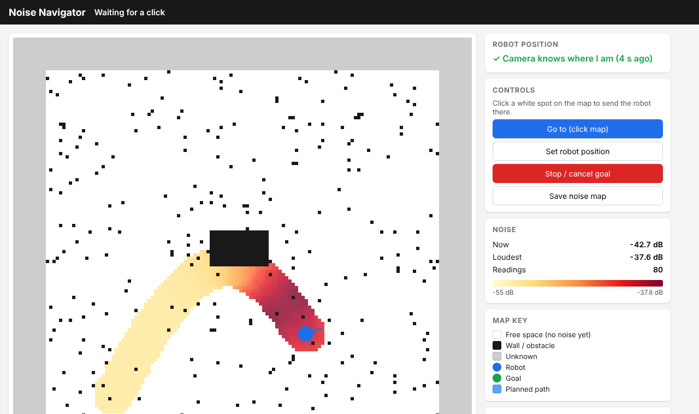
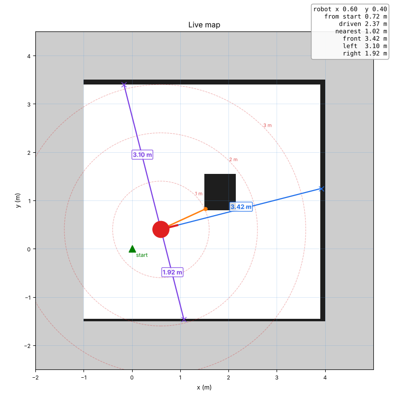

# TurtleBot Noise Mapping

A TurtleBot 2 that makes a map of a room with its **camera (visual SLAM)**, then
**drives itself to wherever you click on that map** while two microphones measure
how loud it is. The noise is painted onto the map live, so you can see which
areas are noisy and which side of the robot the sound came from.

Everything is controlled from a web browser on your own PC (Windows, Mac or
Linux) over SSH. Nothing needs to be installed on the PC.


*The click-to-go page, shown with simulated test data. Yellow = quiet, dark red = loud.*

---

## Contents

- [What it does](#what-it-does)
- [Hardware](#hardware)
- [How it works](#how-it-works)
- [Repository layout](#repository-layout)
- [What each file does](#what-each-file-does)
- [Installation (once)](#installation-once)
- [Watching from your PC](#watching-from-your-pc)
- [Part 1 - Make the map](#part-1---make-the-map)
- [Part 2 - Noise map with click-to-go navigation](#part-2---noise-map-with-click-to-go-navigation)
- [Output files](#output-files)
- [Settings you can change](#settings-you-can-change)
- [Troubleshooting](#troubleshooting)
- [Limitations](#limitations)
- [Background](#background)

---

## What it does

**Part 1 - Make the map** (`run_vslam_mapping.sh`)
- You drive the robot around with the keyboard.
- **RTAB-Map** (visual SLAM) uses the depth camera to work out where the robot
  is and to draw a 2D map of the room.
- The map is shown live in your browser, with distances: a 1 m grid,
  1 / 2 / 3 m rings around the robot, and the distance to the nearest obstacle
  in front, left and right.
- When you press Ctrl-C the map is saved (`~/vslam_map.db` + a `.png` picture).

**Part 2 - Noise map** (`run_vslam_noise_nav.sh`)
- Open a web page, **click a white spot on the map** and the robot plans a route
  and drives there by itself.
- The **camera** recognises the room and works out where the robot is on the
  saved map (no LiDAR needed for this).
- The **LiDAR** spots obstacles while driving so the robot doesn't hit them.
- **Two USB microphones** (left and right side of the robot) measure the noise
  every half second. Each reading is painted onto the map: the **left half**
  of the painted circle uses the **left mic**, the **right half** the **right
  mic**, so the side the sound came from shows up darker.
- Press Ctrl-C (or the **Save** button) to save the noise map picture and a CSV
  of every reading.

---

## Hardware

| Part | Used for | Needed in |
|---|---|---|
| TurtleBot 2 (Kobuki base) + laptop, Ubuntu 20.04, ROS Noetic | Driving, odometry | Part 1 + 2 |
| Orbbec Astra depth camera (the TurtleBot's normal 3D sensor) | Visual SLAM + finding the robot on the map | Part 1 + 2 |
| Hokuyo URG-04LX-UG01 LiDAR | Obstacle avoidance while driving | Part 2 |
| 2 cheap USB microphones, one on each side of the robot | Left / right noise | Part 2 (optional - falls back to the camera's mic) |
| Any PC with SSH and a web browser | Watching and clicking | Part 1 + 2 |

**Mounting tips**
- LiDAR: mounted level, facing forward, on the robot's top plate.
- Microphones: on **opposite sides**, facing **outwards**, as far apart as possible
  (about 30 cm), away from the wheels and the laptop fan. The robot's body
  between them helps each mic hear its own side.

---

## How it works

```
 PART 1 - MAPPING                               PART 2 - NOISE MAPPING
 -------------------------                      -------------------------------------------
 keyboard -> robot base                          web page click -> move_base (plans a path, drives)
 wheels   -> odometry ---------+                                     ^             ^
 camera   -> RTAB-Map (SLAM) --+-> /map          camera -> RTAB-Map (localization) -> robot position on map
                                |                 /map -> map_cleaner -> /map_clean (planner's map)
                         map_viewer.py            LiDAR -> scan_filter -> obstacle avoidance
                                |                 2 USB mics -> noise_logger -> /noise_reading
                       browser :8080                                   |
                                                         noise_nav_web.py (map + noise + clicks)
                                                                       |
                                                                 browser :8000
```

| Node / file | What it does |
|---|---|
| `config/vslam.launch` | Starts the camera, RTAB-Map (mapping or localization), the LiDAR and move_base |
| `nodes/map_viewer.py` | Draws the live map with distances, for the browser (Part 1) |
| `nodes/scan_filter.py` | Removes LiDAR points that hit the robot itself (closer than 25 cm) |
| `nodes/map_cleaner.py` | Removes small noisy black specks from the camera map, so the planner can find a path |
| `nodes/noise_logger.py` | Reads the left + right mics, publishes the loudness, saves a CSV |
| `nodes/noise_nav_web.py` | The click-to-go web page: map, noise colours, robot position, buttons |
| `config/hokuyo_costmap.yaml` | Navigation settings (LiDAR obstacles, safety margin, speed, planner) |

---

## Repository layout

```
turtlebot-noise-mapping/
├── run_vslam_mapping.sh       Part 1 - one command starts everything for mapping
├── run_vslam_noise_nav.sh     Part 2 - one command starts everything for noise mapping
├── check_devices.sh           shows what is plugged in where (LiDAR, base, camera, mics)
├── setup_mics.py              one-time setup: which USB mic is left / right
├── config/
│   ├── vslam.launch           camera + RTAB-Map + LiDAR + move_base
│   └── hokuyo_costmap.yaml    navigation settings
├── nodes/
│   ├── map_viewer.py
│   ├── map_cleaner.py
│   ├── scan_filter.py
│   ├── noise_logger.py
│   └── noise_nav_web.py
├── docs/images/               screenshots from simulated tests
└── extras/                    earlier experiments (LiDAR-only SLAM, first noise maps)
```

Maps, recordings and logs are saved in the robot's **home folder** (`~`), not in
the repo (see `.gitignore`).

---

## What each file does

A closer look at every file in the main folder: what it's for, what it reads
and sends, and how it works inside.

### `run_vslam_mapping.sh` - Part 1 launcher

**Purpose:** starts everything needed to make a camera map, in the right order,
in one terminal window.

**Steps it runs:**
1. **Checks** that ROS isn't already running, the repo files exist, and RTAB-Map
   is installed (it picks `rtabmap_slam`, or the older `rtabmap_ros`). Warns you
   if the map name already exists, because it would be replaced.
2. **Robot base:** `roslaunch turtlebot_bringup minimal.launch`, then waits until
   `/odom` (wheel odometry) arrives. If it doesn't, the base is off or unplugged.
3. **Camera + RTAB-Map:** `config/vslam.launch use_lidar:=false`, then checks
   that colour and depth images arrive, that the robot knows where the camera is
   mounted (TF `base_footprint → camera_rgb_optical_frame`), and that a `/map`
   appears.
4. **Viewer:** `nodes/map_viewer.py` + `web_video_server`, which serves port 8080.
5. **Keyboard control** in the same window (`keyboard_teleop.launch`).
6. **On Ctrl-C:** saves the 2D map with `map_saver` (`.pgm` + `.yaml`), turns it
   into a `.png`, then stops every program in reverse order. RTAB-Map writes the
   `.db` file as it shuts down.

**Notes:**
- Each program's output goes to `~/run_logs/<name>.log`, so the window only shows
  the script's own green (`>>>`) and red (`!!!`) messages.
- It finds its own files from the folder it's in, so it works wherever you clone
  the repo.

### `run_vslam_noise_nav.sh` - Part 2 launcher

**Purpose:** starts everything for the click-to-go noise map.

**Steps it runs:**
1. **Checks:** the map `.db` exists, the repo files are there, and RTAB-Map is
   installed.
2. **Finds the LiDAR** by its serial ID (`/dev/serial/by-id/*Hokuyo*`), so it
   works on any USB port, and gives it read/write permission (`sudo chmod`).
3. **Checks for `~/mic_config.json`.** Without it, the camera mic is used.
4. Keeps the **previous noise map** as `*_prev.png` / `*_prev.csv`.
5. Starts, in order, checking each one:

   | Order | Program | Waits for |
   |---|---|---|
   | 1 | Robot base (`minimal.launch`) | `/odom` |
   | 2 | `config/vslam.launch localization:=true navigation:=true` | LiDAR `/hokuyo_scan`, camera images, `/map`, `move_base` |
   | 3 | `nodes/scan_filter.py`, `nodes/map_cleaner.py` | `/map_clean` |
   | 4 | `nodes/noise_logger.py` | `/noise_level` |
   | 5 | `nodes/noise_nav_web.py` (port 8000) + `web_video_server` (port 8080) | - |

6. **Prints** the `ssh` tunnel command with this robot's IP address.
7. **Waits.** Every 5 s it checks that navigation is still running.
8. **On Ctrl-C:** stops everything in reverse order. The web page saves the noise
   map and CSV as it closes.

**Why there's no keyboard control:** while teleop runs, it sends "speed 0" ten
times a second, and the robot's command mixer always obeys the keyboard over
navigation. So clicks would never move the robot.

### `check_devices.sh` - what is plugged in

Prints:
- the LiDAR (`/dev/serial/by-id`, `/dev/ttyACM*`);
- the robot base (`/dev/kobuki`);
- whether the Orbbec camera is on USB (vendor ID `2bc5`);
- all USB devices;
- every sound card, with its **USB port** (for example `1-2.6`);
- the saved mic setup.

Use it after moving cables around.

### `setup_mics.py` - which mic is left and which is right

The two cheap USB mics report **identical names**, and their card numbers can
change after a reboot, so they're identified by **physical USB port** instead.

1. **Finds USB microphones.** It ignores the camera's mic and the laptop's
   built-in mic.
2. **Clap test:** records **all mics at the same time** while you clap next to
   the left mic, then the right one. For each mic it measures the level of the
   loudest 5% of 20 ms frames, which is where the claps are. The mic that's much
   louder for left claps becomes **left**, and the other becomes **right**. It
   insists on at least a 2 dB difference, otherwise it asks you to repeat.
3. **Calibration:** with a steady sound in front, which reaches both mics equally,
   it measures how many dB louder the left mic reads (the median over the loud
   frames). That **offset** is later subtracted, so both mics are compared fairly.
4. **Saves** `~/mic_config.json`, with the left and right USB ports, the names
   and the offset.

### `config/vslam.launch` - camera, SLAM, LiDAR and navigation

One launch file used by both parts. The main options:

| Option | Part 1 | Part 2 | Meaning |
|---|---|---|---|
| `localization` | false | true | false = build a new map (the old `.db` is deleted); true = load the map and only work out where the robot is |
| `navigation` | false | true | Also start `move_base` (path planning + driving) |
| `use_lidar` | false | true | Start the Hokuyo driver |
| `rtabmap_use_scan` | - | false | RTAB-Map itself uses only the camera; the LiDAR is just for obstacles |
| `grid_sensor` | 1 | 1 | The 2D map is drawn from the camera (0 = LiDAR, 2 = both) |
| `database_path` | `~/vslam_map.db` | same | Map file |
| `port`, `laser_z`, `laser_yaw` | - | auto | LiDAR port and mounting |

**What it starts:**
- **Hokuyo driver** (`urg_node`), publishing `/hokuyo_scan`, plus a fixed
  transform saying where the LiDAR sits on the robot (`base_footprint → laser`).
- **The camera:** the TurtleBot's `3dsensor.launch`, which gives colour images,
  depth images, and the camera's position on the robot.
- **RTAB-Map**, which:
  - takes the colour + depth images plus the wheel odometry;
  - finds visual features (corners, edges) in each image, and uses their depth
    to work out how the robot moved;
  - remembers what each place looks like, so when it sees a place again it
    corrects the drift (**loop closure**);
  - turns the depth points into a 2D map: floor = free, anything up to 1.2 m
    tall = obstacle, ceiling ignored; isolated noisy points are filtered out;
  - publishes the map on `/map`;
  - in localization mode, publishes `/rtabmap/localization_pose` each time it
    recognises a place;
  - accepts `/initialpose`, which is what the "Set robot position" button sends.
- **move_base** (when `navigation:=true`): the standard TurtleBot navigation, with
  the settings from `hokuyo_costmap.yaml`. It reads the obstacles from
  `/hokuyo_scan_filtered`.

### `config/hokuyo_costmap.yaml` - navigation settings

Changes from the TurtleBot defaults:
- **Uses the LiDAR at any mounting height.** By default, only scans between
  0.25 and 0.35 m are accepted.
- **Plans on `/map_clean`,** the camera map with the specks removed.
- **Safety margin (inflation) of 0.30 m,** so narrow gaps aren't closed off.
  The robot itself is about 0.18 m in radius.
- **Top speed of 0.25 m/s.**
- **The planner may go through grey (unknown) areas** (`allow_unknown: true`),
  and accepts a goal within 0.3 m if the clicked spot itself is blocked.

### `nodes/map_viewer.py` - live map with distances (Part 1)

| | |
|---|---|
| Reads | `/map`, robot position (TF `map → base_footprint`) |
| Sends | `/map_image` (picture, 2 per second) → viewed through `web_video_server` |

**How it works:**
- **Crops** the map to the explored area, and draws free = white, walls = black,
  unknown = grey.
- **Adds a 1 m grid**, and rings at 1, 2 and 3 m around the robot.
- **Distance lines:** casts a ray **forward, left and right** from the robot,
  stepping 2.5 cm at a time, until it hits a black cell. That distance is shown
  in metres. A ray that reaches grey first is drawn dotted, with "?".
- **Nearest obstacle:** finds the closest black cell within 5 m (orange line).
- **Info box:** position, distance from the start, and distance driven. Jumps
  over 1 m are ignored, because those happen when SLAM corrects itself.

### `nodes/scan_filter.py` - ignore the robot's own body

| | |
|---|---|
| Reads | `/hokuyo_scan` |
| Sends | `/hokuyo_scan_filtered` |

The LiDAR sees parts of the TurtleBot (posts, cables, the camera). Without this,
navigation thinks the robot is already touching an obstacle and refuses to move
("potential collision, cost -1"). Every reading closer than `min_range`
(0.25 m) is replaced with "no reading".

### `nodes/map_cleaner.py` - remove specks from the camera map

| | |
|---|---|
| Reads | `/map` |
| Sends | `/map_clean` (latched, so late subscribers still get it) |

The camera map has many small black specks, from noisy depth near chair legs and
shiny or dark surfaces. The planner treats each one as a wall, plus a safety
margin, so it often found **no path at all**. This node fixes that:
1. **Finds the black blobs:** groups black cells that touch, including
   diagonally, into blobs (8-connected component labelling, using scipy if
   installed, otherwise a simple flood fill).
2. **Removes small ones:** any blob smaller than `min_area` (0.05 m², about
   22 × 22 cm) becomes free space. Walls and furniture are big connected blobs,
   so they stay.
3. **Publishes** the cleaned map.

Real small obstacles that get removed are still avoided, because the LiDAR sees
them live while driving.

### `nodes/noise_logger.py` - measure the noise

| | |
|---|---|
| Reads | Left + right USB mics (or the camera mic), robot position from `/odom` |
| Sends | `/noise_level`, `/noise_left`, `/noise_right`, `/noise_balance`, `/noise_reading` |
| Saves | CSV (`~/noise_log.csv` when started by the run script) |

**How it works:**
1. **Picks the mics:** looks up the current card number for each saved USB port
   in `~/mic_config.json`, and records each mic with `arecord` (16 kHz, mono) in
   its own background thread.
2. **Measures loudness:** every **0.5 s** it takes one reading per mic:
   - `peak` (default): the RMS of the **loudest 50 ms** in that half second, so
     claps and short sounds aren't averaged away;
   - `average`: the RMS of the whole half second.
3. **Converts to dB:** `dB = 20·log10(rms / 32768)`, so 0 dB is the loudest the
   mic can record. The left mic's calibration offset is subtracted.
4. **Combines the mics:**
   - **overall** = the average sound *power* of both mics (not an average of the
     dB numbers);
   - **balance** = left − right. More than +1.5 dB means **LEFT**, less than
     −1.5 dB means **RIGHT**, anything else is **centre**.
5. **Keeps the mics in step:** the two USB mics have separate clocks, so if one
   runs ahead, its old readings are dropped.
6. **Without `mic_config.json`:** reads the camera's stereo mic instead.

### `nodes/noise_nav_web.py` - the click-to-go noise map page

The main program for Part 2. It's a small web server, built into Python, plus a
ROS node.

| | |
|---|---|
| Reads | `/map_clean` (or `/map`), `/noise_reading`, robot position (TF), planned path, `/rtabmap/localization_pose` |
| Sends | Goals to `move_base` (action), `/initialpose`, `/move_base/clear_costmaps` |
| Serves | `http://localhost:8000` (only reachable through the SSH tunnel) |
| Saves | `~/noise_nav_map.png`, `~/noise_nav_log.csv` |

**Painting the noise:** every reading paints a **circle 0.4 m in radius** around
the robot, split along the direction the robot faces:
- the **left half** gets the **left mic's** dB, and the right half the right
  mic's;
- for each map cell it stores the **sum, count and maximum** of all readings
  painted there;
- **Loudest** view colours each cell by its maximum, and **Average** view by
  sum ÷ count;
- colours run from **yellow** (quietest so far) through orange to **dark red**
  (loudest so far);
- walls are never painted over.

**Clicks:**
- **A click on the map:** the position is turned into map coordinates. Walls and
  grey areas are refused. It clears old obstacles, then sends a goal to
  `move_base`, facing from the robot towards the clicked point.
- **Set robot position:** two clicks, where the robot is and which way it faces.
  These go to RTAB-Map on `/initialpose`.

**The page itself** (HTML + JavaScript inside the same file) refreshes the map
picture and the status once a second. The status includes the nav state, the
noise now and loudest, the direction, the position, and whether the camera has
recognised the room recently.

| Web address | What it does |
|---|---|
| `GET /` | The page |
| `GET /map.png` | Current map picture |
| `GET /api/status` | Status as JSON |
| `POST /api/goal`, `/api/pose`, `/api/cancel`, `/api/clear`, `/api/save`, `/api/view` | The buttons |


---

## Installation (once)

All commands are run **on the robot's laptop** (over SSH from your PC is fine:
`ssh robot@<robot-ip>`).

### 1. ROS packages

The standard TurtleBot 2 packages (`turtlebot_bringup`, `turtlebot_teleop`,
`turtlebot_navigation`) must already be installed. Then:

```bash
sudo apt update
sudo apt install ros-noetic-rtabmap-ros ros-noetic-urg-node \
                 ros-noetic-web-video-server ros-noetic-map-server \
                 python3-numpy python3-matplotlib
# optional, makes the map cleaner faster:
sudo apt install python3-scipy
```

Check everything is found (each line should print a folder, not "not found"):

```bash
rospack find rtabmap_slam; rospack find urg_node; rospack find web_video_server
rospack find map_server; rospack find turtlebot_navigation; rospack find move_base
```

### 2. Get the code

Clone the GitHub repository onto the robot's laptop, then go into the folder
that contains this README (`turtlebot-noise-mapping`):

```bash
cd ~
git clone https://github.com/<your-username>/<your-repo>.git
cd <your-repo>/turtlebot-noise-mapping
chmod +x *.sh *.py nodes/*.py
```

All the commands below are run from this folder. The scripts find their other
files relative to where they are, so the folder can live anywhere.

### 3. Camera setting

The TurtleBot must know the camera model, so it knows where the camera sits on
the robot:

```bash
echo $TURTLEBOT_3D_SENSOR        # should print: astra
```

If it doesn't, add `export TURTLEBOT_3D_SENSOR=astra` to the end of `~/.bashrc`
and open a new terminal.

### 4. LiDAR permission (optional, makes it permanent)

The run script gives the LiDAR permission each time (it asks for the robot's
password). To never be asked again:

```bash
sudo usermod -a -G dialout $USER     # then log out and back in
```

### 5. Check the devices

```bash
./check_devices.sh
```

You should see the Hokuyo LiDAR, `/dev/kobuki` (robot base), the Orbbec camera
and your two USB microphones with the USB port each is in.

### 6. Set up the two microphones

With nothing else running:

```bash
python3 setup_mics.py
```

It walks you through it:
1. clap 4-5 times next to the **left** mic,
2. clap 4-5 times next to the **right** mic,
3. play steady music about 1 m **in front** of the robot for 6 seconds
   (corrects for one mic being more sensitive).

It saves `~/mic_config.json`. The mics are remembered **by USB port**, so keep
them plugged into the same ports (label the plugs L and R). Run it again if you
move them or change the mic volume.

**Mic volume** (same value for both - check the card numbers with `arecord -l`):

```bash
amixer -c 1 sset Mic 100%
amixer -c 3 sset Mic 100%
sudo alsactl store            # keep after reboot
```

No USB mics? Skip this step - the noise logger then uses the camera's built-in
mic (overall loudness only; it can't tell left from right).

---

## Watching from your PC

The robot serves two web pages. Open an SSH **tunnel** from your PC (PowerShell
on Windows, Terminal on Mac/Linux) and **leave that window open**:

```bash
ssh -L 8000:localhost:8000 -L 8080:localhost:8080 robot@<robot-ip>
```

Then open in your browser (paste into the address bar, not the terminal):

| Page | Address |
|---|---|
| Live map with distances (Part 1) | http://localhost:8080/stream_viewer?topic=/map_image |
| Camera view (Part 1 + 2) | http://localhost:8080/stream_viewer?topic=/camera/rgb/image_raw |
| Click-to-go noise map (Part 2) | http://localhost:8000 |

The run scripts print the exact `ssh` command with your robot's IP.

> Why a tunnel? On many networks only SSH reaches the robot directly, so
> `http://<robot-ip>:8080` gives "site can't be reached". The tunnel sends the
> pages through the SSH connection instead.

---

## Part 1 - Make the map

1. **Turn the robot base on.** The LiDAR isn't needed for this part.
2. **Mark the start spot**: put the robot where you want the map to start and
   put tape on the floor with an arrow showing which way it faces.
   You'll start Part 2 from the same spot.
3. **Stop any running ROS programs** (Ctrl-C in old robot windows).
4. **Run** (on the robot, in the repo folder):
   ```bash
   ./run_vslam_mapping.sh              # saves as vslam_map
   ./run_vslam_mapping.sh vslam_map2   # or choose a name
   ```
   It starts the robot base, camera and RTAB-Map, checks each one, then gives
   you **keyboard control in the same window**.
5. **Open the tunnel and the map page** on your PC (see above).
6. **Drive** with the keys shown (`i` forward, `j`/`l` turn, `k` stop, `,` back):
   - drive and **turn slowly** - fast turns blur the camera and it gets lost;
   - point the camera at furniture and posters, not blank walls or glass;
   - at the end, drive back past where you started - recognising a place
     again corrects the whole map.
7. **Press Ctrl-C** when the map looks complete. It saves:
   - `~/vslam_map.db` - the visual SLAM map (needed for Part 2)
   - `~/vslam_map.png`, `.pgm`, `.yaml` - the 2D map picture


*Map viewer during mapping (simulated room): blue = distance ahead, purple =
left / right, orange = nearest obstacle, dashed rings = 1 / 2 / 3 m.*

---

## Part 2 - Noise map with click-to-go navigation

1. **Plug in the LiDAR** and make sure the robot base is on.
2. **Put the robot on the start spot** from Part 1, facing the same way.
3. **Stop any running ROS programs** (Ctrl-C in old robot windows).
4. **Run** (on the robot, in the repo folder):
   ```bash
   ./run_vslam_noise_nav.sh              # uses ~/vslam_map.db
   ./run_vslam_noise_nav.sh vslam_map2   # or another map
   ```
   It finds the LiDAR on whichever USB port it is in, starts the robot base,
   camera localization, LiDAR, navigation, map cleaner, noise logger and the
   web page, and checks each one.
5. **Open the tunnel**, then **http://localhost:8000** on your PC.
6. **Wait for the green tick** in the *Robot position* box
   ("✓ Camera knows where I am"). If it stays red:
   - click **Set robot position**, click where the robot really is, then click
     again in the direction it is facing; **or**
   - turn the robot slowly on the spot with keyboard control in **another**
     window (`roslaunch turtlebot_teleop keyboard_teleop.launch`) until the camera
     recognises the room - then **Ctrl-C that window** (while it runs it blocks
     the clicks).
7. **Click a white spot** on the map. The robot plans a route (blue dotted
   line) and drives there. Click again for the next spot.
8. **Watch the noise** appear along the way:
   - **Loudest** view (default): each spot shows the loudest sound heard there -
     claps and short sounds show up.
   - **Average** view: each spot shows its typical noise level.
   - **Direction**: LEFT / RIGHT / centre, from the two mics.
9. **Finish**: click **Save noise map**, or press **Ctrl-C** in the robot
   window (saves and shuts everything down).

**Page buttons**

| Button | What it does |
|---|---|
| Go to (click map) | Click mode - click a white spot to send the robot there |
| Set robot position | Click where the robot is, then the direction it faces |
| Stop / cancel goal | Stops the robot immediately |
| Clear obstacles (if stuck) | Makes the robot forget old obstacles; the LiDAR re-detects real ones. Also done automatically before each new goal |
| Save noise map | Saves the picture and CSV now |
| Loudest / Average | How the noise colours are calculated |

**Copy the results to your PC** (in PowerShell / Terminal on your PC):

```bash
scp robot@<robot-ip>:~/noise_nav_map.png .
scp robot@<robot-ip>:~/noise_nav_log.csv .
scp robot@<robot-ip>:~/vslam_map.png .
```

---

## Output files

All saved in the robot's home folder (`~`).

| File | Made by | Contents |
|---|---|---|
| `vslam_map.db` | Part 1 | RTAB-Map visual SLAM map (used by Part 2) |
| `vslam_map.png` / `.pgm` / `.yaml` | Part 1 | 2D map picture + ROS map files |
| `noise_nav_map.png` | Part 2 | Map with the noise painted on it |
| `noise_nav_log.csv` | Part 2 | `time_s, x_m, y_m, heading_deg, noise_dB, left_dB, right_dB, balance_dB, side` |
| `noise_log.csv` | Part 2 | Raw logger output: `time_s, x_m, y_m, noise_dB, left_dB, right_dB, balance_dB` (odometry position) |
| `noise_nav_map_prev.png`, `noise_nav_log_prev.csv` | Part 2 | The previous run, kept when you start a new one |
| `mic_config.json` | `setup_mics.py` | Which USB port is the left / right mic, plus sensitivity correction |
| `run_logs/*.log` | both | Output of every program - look here when something fails |

**About the dB numbers**: they are relative to the microphone's maximum
(0 dB = loudest it can record), so they are always negative and closer to 0
means louder. They are good for comparing places, but they are not calibrated
sound-meter (dB SPL) readings.

---

## Settings you can change

| Setting | Where | Default | Effect |
|---|---|---|---|
| Map name | `./run_vslam_mapping.sh NAME`, `./run_vslam_noise_nav.sh NAME` | `vslam_map` | Keep several maps |
| Robot speed | `config/hokuyo_costmap.yaml` → `max_vel_x`, `max_vel_trans` | 0.25 m/s | Slower = quieter robot, better readings |
| Safety margin | `config/hokuyo_costmap.yaml` → `inflation_radius` | 0.30 m | Smaller lets it through narrow gaps |
| Speck removal | `nodes/map_cleaner.py` `_min_area` | 0.05 m² | Bigger removes more noise from the camera map (too big removes furniture) |
| LiDAR self-hits | `nodes/scan_filter.py` `_min_range` | 0.25 m | Raise if the LiDAR sees parts of the robot |
| Noise measurement | `nodes/noise_logger.py` `_level` | `peak` | `peak` = loudest 50 ms of each half second (catches claps); `average` = steady noise |
| LEFT/RIGHT threshold | `nodes/noise_logger.py` `_side_db`, `nodes/noise_nav_web.py` `SIDE_DB` | 1.5 dB | Lower = reacts to smaller differences |
| Paint size | `nodes/noise_nav_web.py` `RADIUS` | 0.4 m | Size of the circle each reading paints |
| Camera map noise filter | `config/vslam.launch` `Grid/NoiseFilteringRadius` | 0.05 m | Fewer specks in **new** maps |
| LiDAR mounting | `vslam.launch` args `laser_z`, `laser_yaw` | 0.3 m, 0 | Use `laser_yaw:=3.14159` if it faces backwards |

Options for the nodes are given ROS-style, e.g. to run the logger by hand:

```bash
pkill -f noise_logger.py
python3 nodes/noise_logger.py _level:=average _side_db:=3
```

**Useful ROS topics**

| Topic | Type | Contents |
|---|---|---|
| `/map` | OccupancyGrid | Map from RTAB-Map |
| `/map_clean` | OccupancyGrid | Map with small specks removed (used for planning) |
| `/map_image` | Image | Live map with distances (Part 1 viewer) |
| `/hokuyo_scan`, `/hokuyo_scan_filtered` | LaserScan | LiDAR, raw and without hits on the robot |
| `/noise_level`, `/noise_left`, `/noise_right` | Float32 | Loudness in dB |
| `/noise_balance` | Float32 | Left minus right (dB): + = louder on the left |
| `/noise_reading` | Float32MultiArray | `[overall, left, right, balance]` together |
| `/rtabmap/localization_pose` | PoseWithCovarianceStamped | Sent when the camera recognises a place |

---

## Troubleshooting

| What you see | Cause | Fix |
|---|---|---|
| `!!! ROS is already running` | An old run is still going | Ctrl-C in the other robot windows |
| `!!! No /odom from the robot base` / gmapping or RTAB-Map "Dropped 100% of messages" | The base isn't talking to the laptop | Switch the base ON (LED lit), check its USB cable, `ls /dev/kobuki` |
| `Could not open serial Hokuyo` / `!!! LiDAR not found` | LiDAR unplugged or no permission | Plug it in; the script runs `chmod` for you; or do installation step 4 |
| `!!! No camera images` | Camera unplugged / not enough USB bandwidth | `./check_devices.sh`; try a USB port directly on the laptop |
| `run_id on parameter server does not match` | Two launches started at the same moment | Use the run scripts (they start things in order) |
| Browser: "site can't be reached" | No tunnel, or the web server isn't running | Open the `ssh -L ...` tunnel; check the script reached its last step; use `http://` not `https://` |
| Browser page loads but stays blank | Old stream from before a restart | Reload the page (Ctrl+F5) |
| Tunnel window prints `channel 3: open failed` | The page's server isn't running on the robot | Check the run script is still running and reached its last step |
| Robot arrow points the wrong way | Robot wasn't facing the same way as when the map started, and the camera hasn't recognised the room yet | Use **Set robot position**, or turn it slowly until the box turns green |
| Click does nothing, `Aborting because a valid plan could not be found` in `run_logs/vslam.log` | No route through the map's black areas | Click a big open white area closer by; raise `_min_area` in the map cleaner; remake the map |
| Robot spins on the spot then stops | Recovery behaviour - it couldn't find a way | Same as above; press **Clear obstacles**; drive it into open space |
| Clicks are ignored | Keyboard teleop is running (it keeps sending "stop" and overrules navigation) | Ctrl-C the teleop window |
| Noise always says `centre` / both halves the same | Mics too close together, or the sound is in front/behind | Mount mics on opposite sides facing out; re-run `setup_mics.py`; use **Loudest** view |
| `USB mic not found on port ...` | Mics plugged into different USB ports than at setup | Plug them back into the same ports, or re-run `setup_mics.py` |
| `Unable to connect / Connection refused` when starting a node by hand | ROS (roscore) isn't running | Start the run script first |
| `rosrun image_view ...` crashes with `cannot open display` | Pop-up windows don't work over plain SSH | Use the browser pages instead |

---

## Limitations

- **Direction is left / right only.** Two mics side by side can't tell front
  from back. Loudness difference (not timing) is used, because two separate USB
  mics don't share a clock.
- **The camera's built-in mic can't tell direction.** We tested it with claps on
  each side: the two channels were nearly identical, so the USB mics are used.
- **The robot hears itself.** Wheels, motors and the laptop fan add noise.
  Drive slowly, mount the mics high and away from the wheels, and compare runs
  done at the same speed.
- **dB values are relative**, not calibrated sound levels (see above).
- **The camera map is noisy** near shiny, dark or glass surfaces and only sees
  about 60° in front, so it fills in more slowly than a LiDAR map.
  `map_cleaner.py` removes small specks; real small obstacles are still avoided
  because the LiDAR sees them live.

---

## Background

This is a measurement-based take on **noise maps** for mobile robots: instead of
locating sound sources and predicting the noise everywhere (as in Martinson's
work), the robot simply measures the loudness wherever it drives and paints it
onto a SLAM map.

- E. Martinson, *Noise Maps for Acoustically Sensitive Navigation*, Georgia Tech, 2004 -
  https://repository.gatech.edu/entities/publication/14a10ebb-1170-410d-b4e4-2f0eb455e2cb
- E. Martinson, *Robotic Discovery of the Auditory Scene* -
  https://repository.gatech.edu/entities/publication/578164f4-9558-4c55-9bf2-9674139cdbc1
- RTAB-Map ROS - https://github.com/introlab/rtabmap_ros
- `respeaker_ros` (for a proper direction-finding mic array, if you upgrade) -
  https://index.ros.org/p/respeaker_ros/

## Extras

`extras/` holds earlier experiments: LiDAR-only SLAM with gmapping and an
autonomous explorer, and the first noise-map scripts. See
[`extras/README.md`](extras/README.md).
